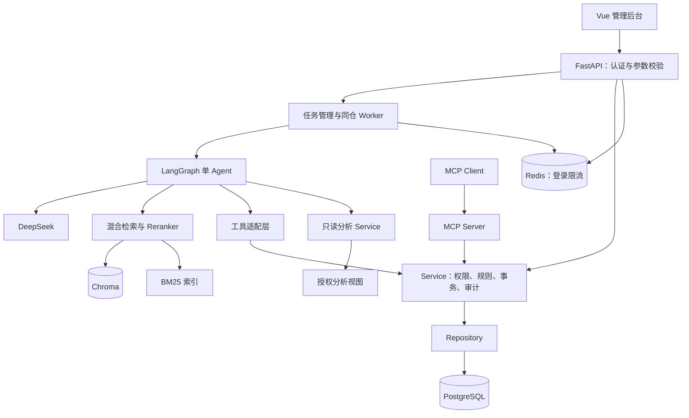

# EnterpriseAgent

基于 LangGraph、Agentic RAG 与 MCP 的企业级电商智能业务助手，面向中国大陆 AI Agent 开发工程师求职展示。使用模拟电商数据，逐步实现可运行、可测试、可评估的业务系统。

**当前版本：0.2.0，Phase 2 数据库、认证和订单售后 API。** 已实现 PostgreSQL 模型、Alembic、模拟数据、JWT、订单归属、确定性退款规则、用户确认、幂等与审计。RAG、LangGraph、MCP、自然语言分析和 Vue 后台尚未实现。

## 功能与进度

| 模块 | 当前状态 | 范围 |
| --- | --- | --- |
| FastAPI 基础服务 | 已实现 | 应用工厂、配置、请求 ID、JSON 日志、CORS、统一错误 |
| 数据库与认证 | Phase 2 已实现 | 15 张业务表、Alembic、seed、Argon2、JWT、实时角色校验 |
| 订单与售后 API | Phase 2 已实现 | 查询、资格、确认、申请、客服审核、模拟完成、幂等、审计 |
| 基础设施 Compose | Phase 2 已实现 | PostgreSQL、Redis、健康检查、开发/测试库隔离、D 盘数据 |
| 企业知识库 | Phase 3 计划 | 四类解析、Embedding、混合检索、Rerank、引用、拒答 |
| LangGraph Agent | Phase 4 计划 | Tool Calling、Checkpoint、人工中断、多轮、有限重试 |
| MCP | Phase 5 计划 | 独立 Server、真实 Client、Service 复用 |
| 运营分析 | Phase 6 计划 | NL SQL、视图、只读账号、AST、超时、结果限制 |
| Vue 管理后台 | Phase 7 计划 | 对话、订单、知识库、图表、任务详情 |
| Evaluation | Phase 8 计划 | 数据集、检索对照、真实耗时和 Token |
| 全栈交付 | Phase 9 计划 | 应用容器、CI、干净环境启动、真实截图 |

## 技术栈

当前使用 Python 3.13、FastAPI、Pydantic v2、SQLAlchemy 2.x、psycopg 3、Alembic、PostgreSQL 17、Redis、PyJWT、Argon2、Uvicorn、pytest、pytest-asyncio、HTTPX 和 Ruff。依赖在 [pyproject.toml](pyproject.toml) 声明，在 [requirements/](requirements/) 锁定版本与哈希。

本机 Docker Desktop 4.95.0、Engine 29.8.2、Compose 5.6.0 已实际运行 PostgreSQL `17.11-bookworm` 和 Redis `8.4.7`。API 使用 Windows 项目虚拟环境运行；Linux 应用镜像和全栈部署尚未验证。

后续按阶段验证 LangGraph、DeepSeek 兼容接口、Chroma、中文 BM25、BGE Embedding/Reranker、官方 MCP SDK、Vue 3、TypeScript、Vite、Element Plus。Langfuse 可选，默认关闭。

## 架构

采用模块化单体。当前 API → Service → Repository → PostgreSQL 已实现；图中的 Agent、Worker、RAG、MCP、分析与前端为后续架构。



模型或前端不能直接决定金额、替换身份或修改订单状态。职责和实体关系见 [架构](docs/architecture.md)。

## 项目目录

```text
EnterpriseAgent/
├─ main.py                         # 本地启动入口
├─ pyproject.toml
├─ requirements/                   # 基础/开发锁文件
├─ .env.example                    # 不含实际凭据
├─ src/enterprise_agent/
│  ├─ application.py               # 应用工厂与生命周期
│  ├─ config.py                    # EA_ 配置
│  ├─ database.py                  # 异步 PostgreSQL
│  ├─ security.py                  # Argon2 / JWT / Principal
│  ├─ seed.py                      # 固定种子/日期模拟数据
│  ├─ logging_config.py
│  ├─ request_context.py
│  ├─ api/                         # auth / orders / refunds / health
│  ├─ schemas/
│  ├─ models/
│  ├─ repositories/
│  └─ services/
├─ alembic/                        # 迁移、约束、授权
├─ data/knowledge/                 # 5 份政策；尚未向量索引
├─ tests/                          # 单元、PostgreSQL、HTTP
├─ scripts/                        # 安装、迁移、seed、检查
├─ deploy/                         # 当前只含基础设施 Compose
├─ docs/
└─ var/                            # 密钥、缓存、报告；不提交
```

后续目录按需增加，见 [目标目录](docs/architecture.md#目标目录)。

## 快速启动

在 Windows PowerShell 仓库根目录执行。需要 Python 3.13 虚拟环境和运行中的 Docker Desktop。项目使用 D 盘 `.venv`；首次克隆先在 PyCharm 配置 Python 3.13 并创建 `.venv`，或使用已安装的 Launcher 执行 `py -3.13 -m venv .venv`。

```powershell
Set-Location 'D:\Python\PycharmProjects\EnterpriseAgent'
.\scripts\bootstrap.ps1
.\scripts\init-infra.ps1
.\scripts\migrate.ps1
.\scripts\migrate.ps1 -TestDatabase
.\scripts\seed.ps1
.\scripts\check.ps1
.\scripts\run.ps1
```

`init-infra.ps1` 生成随机 PostgreSQL 密码和 JWT Secret，已有文件不覆盖，并启动基础设施、等待健康。秘密保存在被 Git 忽略的 `var/infra/` 与 `var/infra-secrets.env`，不要打印、提交或复制到文档。`run.ps1` 注入本地应用配置并移除迁移/测试 URL；单独 `python main.py` 需要自行配置环境，空示例配置的 readiness 为 503。迁移/seed 使用初始化账号，API 使用普通账号；测试账号不能连接开发库。见 [部署](docs/deployment.md)。

pip 缓存和 TEMP/TMP 使用项目 `var/cache`、`var/tmp`。Docker 程序位于 `D:\tools\DockerDesktop`，实际 WSL 数据盘位于 `D:\DockerData`；少量 Windows 配置仍可能保留在 C 盘。

访问 [服务信息](http://127.0.0.1:8000/)、[存活](http://127.0.0.1:8000/health/live)、[就绪](http://127.0.0.1:8000/health/ready) 和 [Swagger](http://127.0.0.1:8000/docs)。

本次工作区已保留一个可访问的本地 Demo API。需要重新运行 run.ps1 前，先执行 `scripts/stop.ps1` 停止本项目登记的后台进程，避免 8000 端口冲突；该脚本检查进程是否仍属于当前项目。交互式启动则用 Ctrl+C 关闭。

`/health/ready` 检查数据库连通、迁移版本、应用账号权限，并在配置 Redis 时实际 PING。无数据库或未迁移返回 503。启动不自动迁移、重建或 seed。

## 本地业务 Demo

公开的**模拟账号**共用演示密码 `DemoOnly!2026`：

| 账号 | 用途 |
| --- | --- |
| `demo_customer` | 查询自己的订单、确认退款 |
| `demo_other` | 验证跨客户访问拒绝 |
| `demo_support` | 查询订单、审核、标记模拟完成 |
| `demo_analyst` | 分析角色；分析 API 尚未实现，无订单明细权限 |
| `demo_admin` | 当前可执行客服业务；用户/知识库管理 API 尚未实现 |

`seed.ps1` 默认取当天日期作为 UTC 基准日、随机种子 42 和 500 订单；本阶段实际使用 `-AsOf 2026-10-12` 生成 25 用户、30 商品与约 90 天事实。订单 `10086` 属于 `demo_customer`，商品实付 12900 分、运费 800 分；标准政策不退运费。另有 `10087`（其他客户）、`10088`（超期）、`10089`（未支付）、`10090`（已模拟完成退款）。

API 用当前 UTC 时间判断期限，固定日期数据会变旧；集成测试使用固定时钟。新空库演示可指定新的 seed 日期，seed 不覆盖已有数据。

Swagger 登录后使用 Bearer Token，查询订单、请求 `refund-preview`、人工核对金额/原因/政策，再 `POST /refunds` 显式确认，最后用客服账号审核。确认只创建待审核申请与工单，不执行真实退款。见 [API 和 PowerShell 示例](docs/api.md)。

当前没有 Vue 后台或 Agent 截图。Phase 7 真实浏览器验收后再加入截图，Swagger 不替代前端验收。

## 配置

配置采用 `EA_` 前缀和 SecretStr，主要新增项：

| 变量 | 用途 |
| --- | --- |
| `EA_DATABASE_URL` | 受限应用账号，仅 `postgresql+psycopg` URL |
| `EA_MIGRATION_DATABASE_URL` | 初始化账号，仅迁移/seed |
| `EA_TEST_DATABASE_URL` / `EA_TEST_MIGRATION_DATABASE_URL` | 独立测试库 |
| `EA_REDIS_URL` | 配置后登录限流依赖 Redis，故障时登录 503 |
| `EA_JWT_SECRET` | 至少 32 字符，配置业务数据库时必填 |
| `EA_JWT_EXPIRE_MINUTES` | 默认 30 分钟 |
| `EA_LOGIN_MAX_ATTEMPTS` / `EA_LOGIN_WINDOW_SECONDS` | 默认单 IP 10 次 / 60 秒 |
| `EA_DEMO_PASSWORD` | seed 密码，可覆盖公开默认值 |
| `EA_LLM_ENABLED` / `EA_DEEPSEEK_API_KEY` | 预留，当前不调用模型 |

`.env`、秘密、虚拟环境和运行目录不提交。日志不记录请求体、查询字符串、Authorization 或完整配置。未配置 Redis 时不启用登录限流。

## 测试与 Evaluation

```powershell
.\scripts\check.ps1
.\.venv\Scripts\python.exe -m pytest
```

统一入口加载本地测试配置并要求真实 PostgreSQL，执行 Ruff、格式、pytest、`pip check`，保存 `var/test-results/phase2.xml` 与 `phase2.json`。数据库集成验证迁移、约束、归属、事务、确认、幂等和并发，不能用 SQLite 替代。直接 pytest 未配置测试库时会跳过；`check.ps1 -SkipPostgres` 显式排除数据库测试，不能作为完整阶段验收。

Phase 2 完整真实 PostgreSQL 验收：**191 项通过，0 失败、0 错误、0 跳过**，Ruff 与 pip check 通过，包括真实 TCP / Uvicorn 退款确认、重放、审核、模拟完成及数据库权限隔离。报告耗时 176.147 秒，仅为测试运行时间。环境和限制见 [Phase 2](docs/phase-2.md)。Phase 1 的 **75 项**历史验收保留在 [Phase 1](docs/phase-1.md)。

RAG、模型、SQL 分析和 MCP Evaluation 尚未运行，没有相关准确率、性能或 Token 报告。见 [评估计划](docs/evaluation.md)。

## 技术展示重点

当前可以演示 Service 规则边界、数据库账号隔离、整数金额、发布政策不可变、订单行锁、幂等冲突、同事务退款/工单/审计、用户确认、JWT 撤销版本和实时角色校验，以及 D 盘开发与真实 PostgreSQL 验证。

后续为引用可追溯 RAG、LangGraph 审批恢复、MCP 复用、SQL 多层限制和检索实验。见 [技术决策](docs/technical-decisions.md)。

## 分阶段计划

| 阶段 | 内容 | 验收 |
| --- | --- | --- |
| 1 | 基础工程 | 启动、配置、日志、API 测试；已完成 |
| 2 | 数据库与业务 | 迁移、seed、认证、归属、事务、并发、真实设施 |
| 3 | RAG | 四类解析、索引、混合检索、引用、删除、重索引 |
| 4 | Agent | Tool Calling、人工中断、多轮、Checkpoint、恢复 |
| 5 | MCP | 真实发现和调用、复用 Service |
| 6 | 分析 | 只读账号、SQL AST、查询正确、超时 |
| 7 | 前端 | 构建、真实浏览器流程、引用和确认 |
| 8 | Evaluation | 可复跑数据集、真实对照、耗时和 Token |
| 9 | 全栈交付 | Compose、CI、干净环境、文档和截图 |

每阶段运行适用检查，记录问题和未验证项，形成本地 Git Commit。下一阶段为 Phase 3 知识库，不提前声称 Agent 可用。

## 已知限制

- 模拟业务 API，没有真实支付、退款、客户资料或生产部署。
- 仅整单退款、一单一包裹，没有部分退款、拆单物流。
- 5 份政策已登记，尚未生成 Chunk、Embedding 或向量索引。
- Agent 会话/任务/Chunk 表存在不代表相应功能已实现。
- 没有 LangGraph、MCP、NL SQL、Vue、模型评估或 Langfuse 集成结果。
- Compose 只运行 PostgreSQL/Redis，没有全栈应用镜像、CI 执行或公网发布。
- 公开账号只用于本地演示，不能直接复用到公网环境。
- `/health/ready` 不检查未实现的 Chroma、模型或 Worker。

## 文档与许可证

- [架构](docs/architecture.md)
- [API](docs/api.md)
- [Agent 工作流](docs/agent-workflow.md)
- [Evaluation](docs/evaluation.md)
- [部署](docs/deployment.md)
- [技术决策](docs/technical-decisions.md)
- [Phase 1 历史验收](docs/phase-1.md)
- [Phase 2 验收](docs/phase-2.md)

代码采用 [MIT License](LICENSE)。
