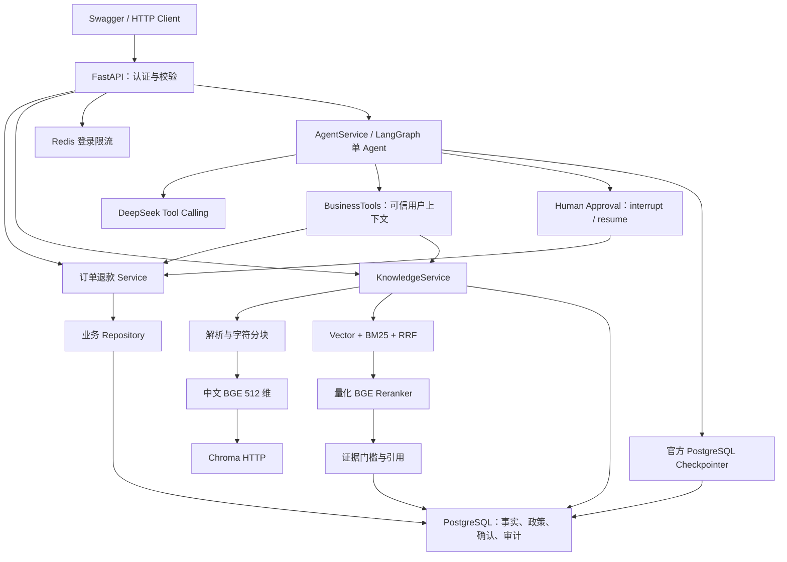

# EnterpriseAgent

基于 LangGraph、Agentic RAG 与 MCP 的企业级电商智能业务助手，面向中国大陆 AI Agent 开发工程师求职展示。项目使用虚构电商数据，以业务规则、权限、事务、可追溯检索和真实验证为重点，分阶段交付。

**当前版本 0.4.0 / Phase 4：LangGraph 单 Agent、知识问答与人工确认退款。** 在真实订单售后和本地混合检索之上加入模型路由、Tool Calling、一次查询改写、多轮会话、官方 PostgreSQL Checkpoint 和中断恢复。知识回答选择并验证引用原文；订单报告根据 Service 事实构造。511项工程测试与真实TCP重启验收通过，DeepSeek在线效果尚未验收；MCP、NL SQL和Vue后台属于后续阶段。

## 功能与技术栈

| 模块 | 当前实现 |
| --- | --- |
| FastAPI 工程 | 配置、JSON 日志、请求 ID、CORS、统一错误与健康检查 |
| 数据库与认证 | PostgreSQL 17、SQLAlchemy 2.x、Alembic、15 张业务表、Argon2、JWT、实时角色校验 |
| 订单与售后 | 查询、资格、用户确认、幂等、待审核退款、客服审核、模拟完成与审计 |
| 知识库 | PDF / DOCX / UTF-8 TXT / Markdown 上传、列表、详情、原件下载、删除、重新索引 |
| 检索 | 512 维中文 BGE、Chroma 1.5.9 HTTP、中文字符/二元组 BM25、RRF、量化 BGE Reranker |
| 来源与权限 | 页码/段落/行号/字符位置、文档与索引版本、公开/内部可见性、失效引用拒绝 |
| Agent | LangGraph 1.2.14、HTTPX DeepSeek 兼容接口、Pydantic 工具参数、有限执行、原文抽取回答 |
| 会话与审批 | 私有 thread、官方 PostgreSQL Checkpoint、多轮历史、人工 interrupt/resume、显式恢复与幂等写入 |
| 评估 | 30 条中文 dev/test 数据集、真实向量与混合重排对照 CLI、JSON / CSV / Markdown |
| 本地部署 | Windows Python 3.13 + Linux PostgreSQL / Redis / Chroma 容器，缓存与数据位于 D 盘 |

AI 检索使用 **真实 CPU ONNX 推理**，通过 FastEmbed 和 ONNX Runtime 运行；模型固定仓库 revision、大小和 SHA256，启动与查询不隐式下载。具体版本见 [pyproject.toml](pyproject.toml)、[哈希锁文件](requirements/) 和模型 manifest。直接知识检索与业务 API 不需要聊天模型 Key；Agent 发消息与执行恢复需配置 DeepSeek，默认 `EA_LLM_ENABLED=false`。

## 架构



业务事实与可执行政策由 Service 和 PostgreSQL 决定；检索文档不能替换身份或直接批准退款。模型只能准备服务器生成的审批摘要，人工确认后 Service 重查并创建待审核申请。审批准备绑定任务、确认使用服务端幂等键，业务提交后丢失 Checkpoint 可显式恢复。索引发布使用尝试代数与 job ID；当前没有独立 Worker 或自动领取任务。详见 [架构](docs/architecture.md)。

## 项目目录

```text
EnterpriseAgent/
├─ main.py
├─ pyproject.toml
├─ requirements/                 # base/dev 版本与哈希锁
├─ .env.example
├─ src/enterprise_agent/
│  ├─ application.py             # 工厂与生命周期
│  ├─ config.py / database.py / security.py
│  ├─ api/                       # 认证、订单、退款、知识库、Agent、健康
│  ├─ models/ schemas/ repositories/ services/
│  ├─ agents/                    # LangGraph / Chat协议 / PostgreSQL Checkpoint
│  ├─ tools/                     # Pydantic工具与业务Service复用
│  ├─ rag/                       # parsing/chunking/ranking/backends/runtime/store
│  ├─ knowledge_cli.py           # 复用 Service 索引已登记文档
│  ├─ evaluation.py              # 真实检索对照
│  └─ seed.py
├─ alembic/                      # 0001_ecommerce → 0002_knowledge → 0003_agent → 0004_agent_role
├─ data/knowledge/               # 5 篇模拟政策
├─ evals/datasets/rag.json
├─ scripts/                      # bootstrap/init/migrate/seed/prepare/index/eval/check/run
├─ tests/                        # 单元、真实 PostgreSQL、真实模型、HTTP
├─ deploy/compose.yaml           # 当前为基础设施容器
├─ docs/
└─ var/                          # 本地秘密、模型、原件、缓存、报告；不提交
```

## 快速启动

Windows PowerShell 在项目根目录执行。需要 Python 3.13 虚拟环境与运行中的 Docker Desktop。首次克隆先在 PyCharm 创建项目 `.venv`；bootstrap 不安装 Python 或 Docker。

```powershell
Set-Location 'D:\Python\PycharmProjects\EnterpriseAgent'
.\scripts\bootstrap.ps1
.\scripts\init-infra.ps1
.\scripts\migrate.ps1
.\scripts\migrate.ps1 -TestDatabase
.\scripts\seed.ps1
.\scripts\prepare-rag.ps1
.\scripts\index-knowledge.ps1
.\scripts\evaluate-rag.ps1
.\scripts\check.ps1
.\scripts\run.ps1
```

首次模型准备显式下载固定版本公开文件，合计 **396,800,683 字节**；可使用可信离线副本与 `prepare-rag-models.py --offline-source`。模型推理只读取校验成功的本地文件。索引脚本处理已登记且未删除的文档，当前 fingerprint 已索引的文档会跳过。评估限定五篇种子文档，不把用户上传内容混入对照。

使用 Agent 前在不提交的 `.env` 设置 `EA_LLM_ENABLED=true` 并填写自己的 `EA_DEEPSEEK_API_KEY`，随后重启。默认 `EA_DEEPSEEK_MODEL=deepseek-flash`，显式禁用 Thinking；Key 只留后端。未配置时发消息返回 `agent_model_not_configured`，不会用测试脚本伪装模型回答。完整配置见 [部署](docs/deployment.md)。

`init-infra.ps1` 生成并保留本地随机 PostgreSQL/JWT 秘密，启动 PostgreSQL、Redis、Chroma。秘密位于被 Git 忽略的 `var/infra/` 和 `var/infra-secrets.env`。迁移和 seed 使用初始化账号；API 与评估使用受限账号。API 启动不自动迁移、seed、下载模型或索引。详情见 [部署](docs/deployment.md)。

项目、`.venv`、pip/TEMP/TMP、模型及报告使用 D 盘。Docker 程序位于 `D:\tools\DockerDesktop`，实际 Docker/WSL 数据盘位于 `D:\DockerData`，三个服务的数据目录位于该盘下；少量 Windows 配置可能仍位于 C 盘。

启动后访问 [Swagger](http://127.0.0.1:8000/docs)、[服务信息](http://127.0.0.1:8000/)、[存活](http://127.0.0.1:8000/health/live)、[就绪](http://127.0.0.1:8000/health/ready)。重启前可运行 `scripts/stop.ps1` 停止本项目登记并验证身份的后台进程，交互式服务用 Ctrl+C 关闭。

## Demo 与 API

公开模拟账号共用密码 `DemoOnly!2026`：

| 账号 | 权限 |
| --- | --- |
| demo_customer / demo_other | 自己的订单退款、公开知识；用于跨客户拒绝演示 |
| demo_support | 订单售后、公开和内部知识 |
| demo_analyst | 公开知识；无订单明细权限，分析 API 尚未实现 |
| demo_admin | 订单售后与知识库上传/删除/重新索引；用户管理 API 尚未实现 |

在 Swagger 登录，再使用 Bearer Token。知识检索：

```http
POST /api/v1/knowledge/search
Content-Type: application/json
Authorization: Bearer <token>

{"query":"已签收订单多久内可以申请退款？","mode":"hybrid_rerank","top_k":5}
```

该直接检索接口仍返回 `answer_mode=evidence_only`、引用、文档版本、Chunk 与位置和各阶段耗时；证据分数不足时为 `insufficient_evidence`。Agent 知识分支可改写一次查询，再调用模型选择原文并逐一校验，不能把相关性分数当作完整语义证明。

Agent Demo：`POST /api/v1/agent/sessions` 创建会话 → 向 `/sessions/{id}/messages` 发送 `{"message":"查询订单 10086 的物流状态"}`。退款请求得到 `waiting_approval` 后，在返回的 `result.approval` 核对订单、金额、原因与政策，再向 `/tasks/{id}/resume` 提交 `approval_id` 和明确的 `confirmed`。客户端不能提供 graph 配置、thread、用户、角色或金额；执行中断时使用 `/tasks/{id}/recover` 核对持久状态。

退款 Demo：查询订单 → `refund-preview` → 人工核对 → `POST /refunds` 明确确认与幂等键 → 客服审核 → 模拟完成。仅创建和管理模拟记录，不调用支付平台。订单 `10086` 属于 demo_customer，商品实付 12900 分、运费 800 分；标准政策不退运费。

seed 默认当天 UTC 基准、随机种子 42、500 订单；本工作区使用 2026-10-12 的固定数据。API 用当前 UTC 判断期限，数据会随时间超期；重复 seed 不覆盖已有数据。业务测试注入固定时钟。

目前没有 Vue 后台或真实浏览器 Demo 截图，Agent 会话通过 Swagger / HTTP 使用。Phase 7 完成后加入实际截图，Swagger 不替代前端验收。完整接口见 [API](docs/api.md)。

## 测试与 Evaluation

```powershell
.\scripts\check.ps1
.\scripts\evaluate-rag.ps1
```

check 默认传 `--require-postgres --require-rag`，执行 Ruff、格式、pytest 与 pip check，保存本阶段 JSON/JUnit。Phase 4 最终 **511项通过，0失败/错误/跳过**，JUnit套件524.068秒，Ruff114文件与pip check通过；81条Chroma第三方legacy embedding弃用警告未屏蔽。真实Uvicorn在待确认阶段停止/重启后仅创建一条退款和工单，重复确认不增记录、越权404；主服务五项健康通过，缺模型Key时503且零任务。查看[验证摘要](evals/results/phase4/verification.json)、[重启证据](evals/results/phase4/http-restart.json)、[主服务HTTP](evals/results/phase4/demo-http.json)与[阶段记录](docs/phase-4.md)。套件耗时不是API性能；受控模型不能证明DeepSeek在线效果。`-SkipPostgres` / `-SkipRag`仅用于局部检查，不能作为完整验收。

Phase 3 完整检查 **309 项通过、0 失败/错误/跳过**，Ruff lint/格式 89 文件与 pip check 通过；真实 TCP 知识库流程 15 项通过。测试套件 327.041 秒，不是 API 性能。官方 SDK 的 51 条 DeprecationWarning 未屏蔽，已归档 [检查摘要](evals/results/phase3/verification.json) 和 [HTTP 验收](evals/results/phase3/http.json)，限制见 [Phase 3 验收](docs/phase-3.md)。Phase 1 的 75 项与 Phase 2 的 191 项保留历史记录，不累计成新指标。

评估集 **30 条，25 可回答 + 5 无证据；dev=10、test=20**。已归档 [最终真实对照](evals/results/phase3/report.md)：test 两组 R@5/MRR/nDCG@5 均为 1，3 条无证据问题均拒绝；vector mean/P95 为 38.529/42.376 ms，hybrid_rerank 为 1008.561/1136.540 ms。混合重排在这个小语料上没有改善文档级指标，延迟更高。初轮暴露门控问题，查看 test 后修正为双门槛；[初轮结果](evals/results/phase3-initial/report.md) 保留，这属于 QA 修正，不能称盲评。运行结束核对源码、数据与模型 manifest hash 稳定；耗时是本机单次观察，不是受控性能基准。生成模型实际调用和输入/输出 Token 均为 0，本地模型 API Token 统计为 N/A。详见 [评估](docs/evaluation.md) 与 [协议](evals/README.md)。

## 技术展示重点

- 数据库事实、结构化政策与检索解释分离；新知识文档不会自动改变退款规则。
- 订单归属、实时角色、JWT 撤销、确认摘要、行锁、幂等及同事务审计。
- 已发布政策及来源文档由 PostgreSQL trigger 保护；允许重索引，禁止删除或替换来源。
- 向量候选与中文 BM25 通过 RRF 融合，真实量化 Reranker 重排，模型来源可复现。
- SQL 可见性与活动代数在检索前后校验，跨库索引发布有明确失败与并发边界。
- 真实模型、数据库、HTTP 与评估结果分别验收，不用控制流程替身冒充模型效果。
- Agent 身份通过可信 Context 注入；模型只能计划，Service 始终检查归属与业务规则。
- 任务关联审批、服务端幂等确认、线程 advisory lock 与显式恢复共同处理跨库提交边界。
- 原文抽取校验与确定性业务报告，记录工具步骤、实际报告的 Token 和未知使用量。

## 后续阶段

| 阶段 | 内容 |
| --- | --- |
| Phase 5 | 官方 MCP Server / Client 与 Service 复用 |
| Phase 6 | NL SQL、授权视图、只读账号、AST、超时与结果限制 |
| Phase 7 | Vue 3 / TypeScript / Element Plus 五个业务页面 |
| Phase 8 | 扩展 Agent、工具、SQL 与回答忠实度评估；可选追踪 |
| Phase 9 | 应用/前端镜像、全栈 Compose、GitHub Actions、干净环境验证 |

每阶段提供代码、适用检查、真实问题、清晰本地 Git Commit 与下一阶段范围。后续设计见 [工作流](docs/agent-workflow.md) 和 [技术决策](docs/technical-decisions.md)。

## 已知限制

- 个人作品、虚构数据，未连接真实企业、支付退款或公网部署。
- 首版整单退款、一单一包裹，没有部分退款、拆单物流或退货寄件。
- PDF 只读已有文本层，无 OCR；DOCX 覆盖正文与表格，不包含页眉页脚、修订文本及文本框；TXT/MD 仅 UTF-8。
- 默认 Chunk 为 500 **字符**、重叠 80；模型输入上限 512 Token，字符不等于 Token，较长内容会被模型截断。
- 本地 CPU 推理、同步请求/CLI 索引，不是独立持久队列或高吞吐生产服务；向量清理失败可能留下旧条目，未知数据库提交结果可能留下未登记原件，没有自动清理工具。
- DeepSeek 在线意图、工具参数与回答质量尚未验收；没有 MCP、NL SQL、Vue 或 Langfuse。
- 知识回答为可追溯原文抽取，能限制文字编造，但不能证明选段语义足够或已识别所有政策冲突。
- Agent 通过请求同步执行、人工等待持久化，不提供流式 UI、独立 Worker、自动任务重领或自动恢复调度。
- 当前 Compose 是基础设施，Windows 应用与 ONNX 推理已验证；Linux 应用镜像和全栈部署尚未验证。
- 小型人工数据集与分数门控不能代表开放式回答语义可靠性。
- 公开演示账号与 loopback 服务不能直接作为公网配置。

## 文档与许可证

[架构](docs/architecture.md) · [API](docs/api.md) · [Agent 工作流](docs/agent-workflow.md) · [Evaluation](docs/evaluation.md) · [部署](docs/deployment.md) · [技术决策](docs/technical-decisions.md) · [Phase 1](docs/phase-1.md) · [Phase 2](docs/phase-2.md) · [Phase 3](docs/phase-3.md) · [Phase 4](docs/phase-4.md)

代码采用 [MIT License](LICENSE)。
