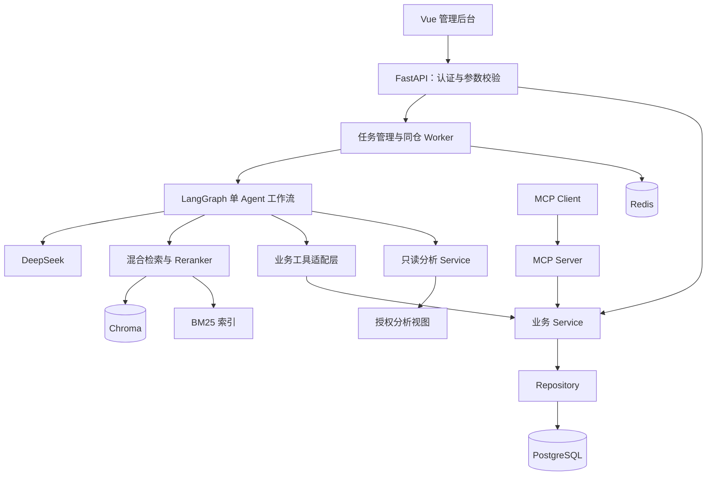

# EnterpriseAgent

基于 LangGraph、Agentic RAG 与 MCP 的企业级电商智能业务助手，面向中国大陆 AI Agent 开发工程师求职展示。项目使用模拟电商数据，逐步实现可运行、可测试、可评估的业务系统。

**当前版本：0.1.0，完成 Phase 1 后端基础工程。** 目前可以启动 HTTP 服务、检查应用健康状态、查看 OpenAPI 文档，并运行配置、日志和 API 测试。数据库、知识检索、Agent、MCP、运营分析和 Vue 后台属于后续阶段；本仓库暂不提供这些业务功能。

## 功能与进度

| 模块 | 当前状态 | 后续验收目标 |
| --- | --- | --- |
| FastAPI 基础服务 | Phase 1 已实现 | 应用工厂、配置校验、健康检查、错误格式、请求 ID、CORS |
| 结构化日志与测试 | Phase 1 已实现 | JSON 日志、敏感信息保护、核心基础测试 |
| 订单与售后 | Phase 2 / 4 计划 | 数据库事实、归属校验、规则判断、确认申请、幂等与审计 |
| 企业知识库 | Phase 3 计划 | PDF / DOCX / TXT / Markdown、混合检索、Rerank、引用与拒答 |
| LangGraph Agent | Phase 4 计划 | 单 Agent 多工具、持久化 Checkpoint、人工确认、有限重试 |
| MCP 工具服务 | Phase 5 计划 | 官方 SDK、独立 Server、真实 Client 调用、复用业务 Service |
| 运营分析 | Phase 6 计划 | NL SQL、授权视图、只读账号、AST 校验、超时与结果限制 |
| Vue 管理后台 | Phase 7 计划 | 对话、订单售后、知识库、图表与任务详情 |
| Evaluation | Phase 8 计划 | 真实数据集与向量 / 混合检索对照实验 |
| 全栈交付 | Phase 9 计划 | Docker Compose、GitHub Actions、部署验证与 Demo 截图 |

## 技术栈

当前基础工程使用 Python 3.13、FastAPI、Pydantic v2、pydantic-settings、Uvicorn、pytest、pytest-asyncio、HTTPX 和 Ruff。依赖在 [pyproject.toml](pyproject.toml) 声明，在 [requirements/](requirements/) 固定版本。当前锁文件在 Windows Python 3.13 环境生成，Linux 安装尚未验证；后续 CI 与容器阶段再生成并验证 Linux 约束。

已确定的后续方向：SQLAlchemy 2.x + PostgreSQL + Alembic、Redis、LangGraph、DeepSeek OpenAI 兼容接口、Chroma、中文 BM25 + 向量检索 + BGE Reranker、官方 MCP Python SDK，以及 Vue 3 + TypeScript + Vite + Element Plus。这些依赖尚未全部安装，实际兼容验证和锁定将在对应阶段执行。Langfuse 为可选接入，默认关闭。

## 架构

采用模块化单体。API、Worker 和 MCP Server 共用业务 Service，Agent 通过受控工具调用 Service。下面表示目标架构，Phase 1 仅实现 API 基础层。



完整职责、实体关系和权限设计见 [架构文档](docs/architecture.md)，工作流见 [Agent 工作流](docs/agent-workflow.md)。

## 项目目录

```text
EnterpriseAgent/
├─ main.py                         # 本地启动入口
├─ pyproject.toml                  # 包与工具配置
├─ requirements/                   # 基础、开发依赖锁文件
├─ .env.example                    # 安全配置示例
├─ src/enterprise_agent/
│  ├─ application.py               # 纯应用工厂
│  ├─ main.py                      # ASGI app 入口
│  ├─ cli.py                       # 配置驱动的 Uvicorn 启动
│  ├─ config.py                    # EA_ 环境变量与校验
│  ├─ logging_config.py            # JSON 日志
│  ├─ request_context.py           # 请求 ID 与安全请求日志
│  ├─ api/                         # API 与请求处理基础设施
│  └─ schemas/                     # 当前响应契约
├─ tests/                          # Phase 1 自动化测试
├─ scripts/                        # Windows 安装与检查入口
├─ docs/                           # 实现说明与后续设计
└─ var/                            # 本地运行数据、缓存和临时文件；不提交
```

后续阶段按需增加 `models/`、`repositories/`、`services/`、`agents/`、`tools/`、`rag/`、`analytics/`、`mcp/`、`alembic/`、`evals/`、`frontend/` 和 `deploy/`。完整目标目录见 [架构文档](docs/architecture.md#目标目录)。

## 快速启动

以下命令在 Windows PowerShell 中执行，工作目录为仓库根目录。需要可运行的 Python 3.13；当前工作区已使用 D 盘项目内 `.venv`。首次克隆仓库时先在 PyCharm 配置项目的 Python 3.13 虚拟环境；若已安装 Python 3.13 和 Windows Python Launcher，也可执行 `py -3.13 -m venv .venv`。`bootstrap.ps1` 使用已有虚拟环境，不负责安装 Python。Phase 1 不需要 Docker、数据库或 DeepSeek Key。

```powershell
Set-Location 'D:\Python\PycharmProjects\EnterpriseAgent'
.\scripts\bootstrap.ps1
.\scripts\check.ps1
.\.venv\Scripts\python.exe main.py
```

`bootstrap.ps1` 先检查 Python 3.13，通过 `--require-hashes` 校验并安装锁定的开发依赖，随后安装可编辑项目包。在缺少 `.env` 时复制示例，已有 `.env` 不会被覆盖。安装和检查脚本均将缓存、临时目录指向项目内 `var/cache`、`var/tmp`，避免默认缓存累积到 C 盘。依赖安装需要网络；HTTP 服务运行本身不需要模型或外部服务。

启动后可访问：

- 服务信息：<http://127.0.0.1:8000/>
- 存活检查：<http://127.0.0.1:8000/health/live>
- 应用就绪检查：<http://127.0.0.1:8000/health/ready>
- Swagger UI：<http://127.0.0.1:8000/docs>

也可以使用 ASGI 入口，适合调试时自动重载：

```powershell
.\.venv\Scripts\python.exe -m uvicorn enterprise_agent.main:app --host 127.0.0.1 --port 8000 --reload --no-access-log
```

推荐使用 `main.py`，由项目统一配置 JSON 日志，并关闭包含原始 URL 的 Uvicorn access log。直接 Uvicorn 命令会使用其自身的启动/错误日志配置，因此示例显式关闭 access log，但不保证所有日志均采用项目 JSON 格式。CLI 的 host / port 控制该命令的监听地址；`main.py` 使用 `EA_HOST` / `EA_PORT`。不要将开发用 `--reload` 用于部署。

手动安装方式以及配置说明见 [部署文档](docs/deployment.md)。

## 配置

复制 `.env.example` 后修改 `.env`。配置通过 `EA_` 前缀读取，并在启动时校验。

| 变量 | 默认值 | 用途 |
| --- | --- | --- |
| `EA_APP_ENV` | `development` | `development` / `test` / `production` |
| `EA_HOST` / `EA_PORT` | `127.0.0.1` / `8000` | `main.py` 监听配置 |
| `EA_LOG_LEVEL` | `INFO` | 日志等级 |
| `EA_DOCS_ENABLED` | `true` | OpenAPI 和 Swagger 文档开关 |
| `EA_CORS_ORIGINS` | `["http://localhost:5173","http://127.0.0.1:5173"]` | 精确配置允许跨域的前端 Origin |
| `EA_DATA_DIR` | `var` | 本地数据目录 |
| `EA_LLM_ENABLED` | `false` | 预留模型配置开关；Phase 1 不调用模型 |
| `EA_DEEPSEEK_BASE_URL` | `https://api.deepseek.com` | 预留 DeepSeek 兼容接口地址 |
| `EA_DEEPSEEK_API_KEY` | 空 | SecretStr 密钥字段；Phase 1 不使用 |
| `EA_DATABASE_URL` / `EA_REDIS_URL` | 空 | 后续连接配置；Phase 1 不建立连接 |

`.env`、上传文件、运行目录和虚拟环境不提交到 Git。日志不记录请求体、查询字符串、Authorization 或配置密钥。不要把 API Key 放在前端代码、截图、测试数据或提交信息中。

启用 `EA_LLM_ENABLED=true` 时配置校验要求非空模型 Key；Phase 1 仍未实现模型 Client，不会因该开关执行聊天或 Agent 调用。

## Demo

Phase 1 Demo 是可实际访问的服务信息和 Swagger 页面，可以查看响应模型、调用健康检查并查看 `X-Request-ID`。目前没有电商后台、Agent 对话或业务 Demo 截图。Phase 7 完成浏览器流程后再添加真实截图及演示步骤。

## 测试与 Evaluation

统一检查入口：

```powershell
.\scripts\check.ps1
```

该脚本依次执行 Ruff lint、格式检查、pytest 和 `pip check`，测试 JUnit 结果写入 `var/test-results/phase1.xml`。

单独运行测试：

```powershell
.\.venv\Scripts\python.exe -m pytest
```

Phase 1 测试覆盖配置输入、应用生命周期、服务信息、健康检查、统一错误、请求 ID、CORS、文档开关和日志敏感信息处理。除进程内 ASGI 测试，还通过真实 CLI 子进程启动服务，在本机 loopback 地址发出 HTTP 请求（`tests/e2e/test_local_server.py`）；另用独立子进程验证非法 `EA_` 环境不会影响纯工厂模块导入。当前测试不代表 PostgreSQL、RAG、模型调用、业务权限或 Docker 集成已经通过。

Evaluation 尚未实现，也没有检索指标或模型 Token 报告。计划和指标定义见 [评估文档](docs/evaluation.md)。后续报告只使用真实执行结果：缺少模型 Key 或服务条件时明确标记跳过，测试替身不作为模型效果证据。

2026-10-12 的 Windows Python 3.13 验收：**75 项测试通过**，Ruff 与依赖一致性检查通过，包含真实 CLI / loopback HTTP 启动。详细证据和未验证范围见 [Phase 1 验收记录](docs/phase-1.md)。

## 技术展示重点

当前可展示：应用工厂与可测试配置、统一 API 契约、生命周期健康检查、请求关联与敏感信息保护、D 盘本地开发脚本、版本锁定和渐进式开发。

后续阶段重点验证：数据库归属与事务边界、退款确认和幂等恢复、引用可追溯的 Agentic RAG、SQL 多层只读限制、MCP 业务复用、检索对照实验。具体取舍见 [技术决策](docs/technical-decisions.md)。

## 分阶段计划

| 阶段 | 内容 | 主要验收 |
| --- | --- | --- |
| 1 | 基础工程 | 启动、配置、日志、错误契约与基础测试 |
| 2 | 数据库与业务 | 迁移、可复现种子、认证、真实数据库权限与事务测试 |
| 3 | RAG | 四类文件解析、真实索引、混合检索、引用、删除与重索引 |
| 4 | Agent | 工具调用、人工确认、多轮状态、持久化与副作用恢复 |
| 5 | MCP | 真实 Server / Client 发现和调用，复用 Service |
| 6 | 分析 | 固定样例查询正确，真实只读账号、SQL 校验与超时限制 |
| 7 | 前端 | 构建通过、浏览器完成核心流程、引用和确认可见 |
| 8 | 评估 | 可复跑数据集、真实对照结果、耗时及 Token 记录 |
| 9 | 交付 | 干净环境 Compose 启动、CI、完整文档与实际截图 |

每个阶段运行适用检查，报告已实现、未解决和未验证事项，并形成清晰的本地 Git Commit。Phase 2 提前提供基础设施 Compose，Phase 9 完成全栈 Compose。后续阶段的功能只有在完成验证后才进入“已实现”列表。

## 已知限制

- 当前没有登录和业务 API，仅适合本机开发与验证；默认监听 `127.0.0.1`。
- `/health/ready` 只表示 Phase 1 应用生命周期就绪，不检查数据库、Redis、Chroma 或模型。
- DeepSeek、PostgreSQL、Chroma、本地 Embedding / Reranker 和 MCP 尚未进行集成验证。
- 当前没有 Evaluation 结果、Docker 部署记录、CI 运行结果或公网部署。
- 目标首版仅支持整单退款、一单一包裹和文本 PDF；部分退款、拆单物流、扫描 PDF OCR 暂不在范围内。
- 项目使用模拟数据与模拟退款状态，不连接真实支付或退款服务。

## 文档与许可证

- [架构与实体关系](docs/architecture.md)
- [当前 API 与后续接口设计](docs/api.md)
- [LangGraph 工作流设计](docs/agent-workflow.md)
- [测试与 Evaluation 计划](docs/evaluation.md)
- [本地开发与部署边界](docs/deployment.md)
- [技术决策](docs/technical-decisions.md)

代码采用 [MIT License](LICENSE)。
