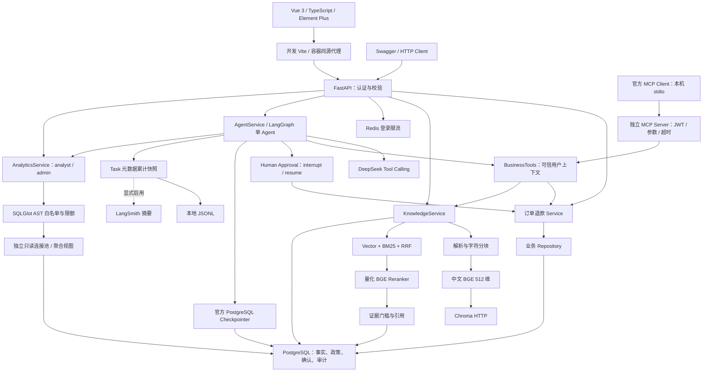
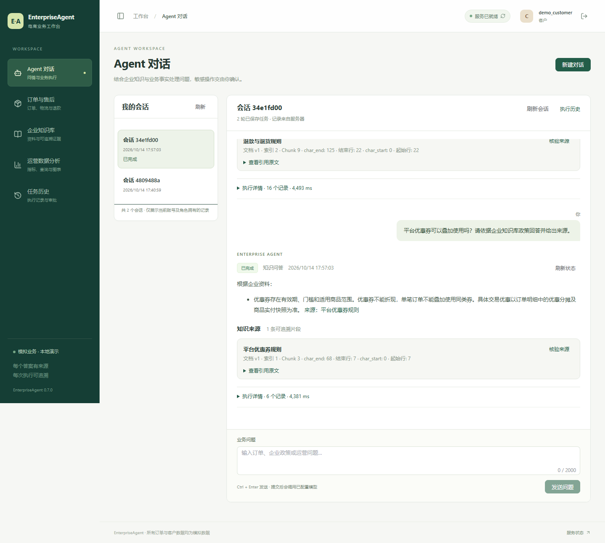
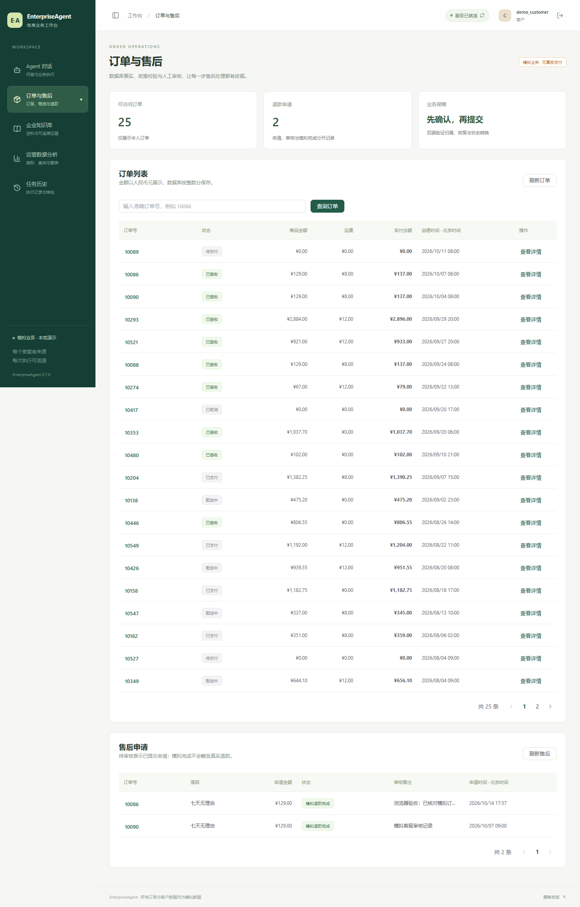
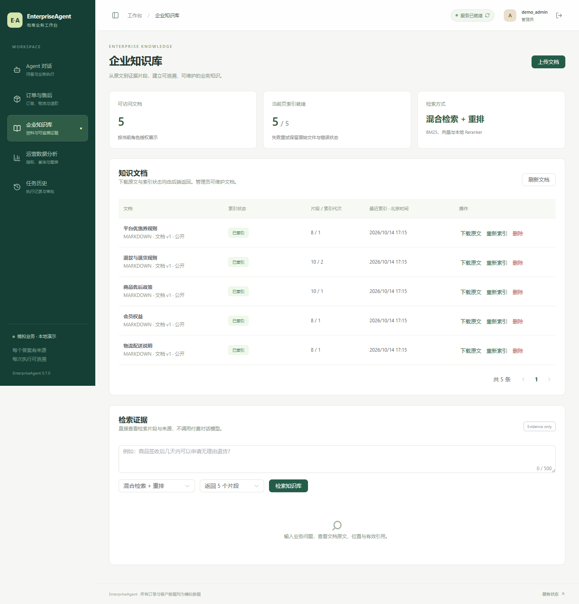
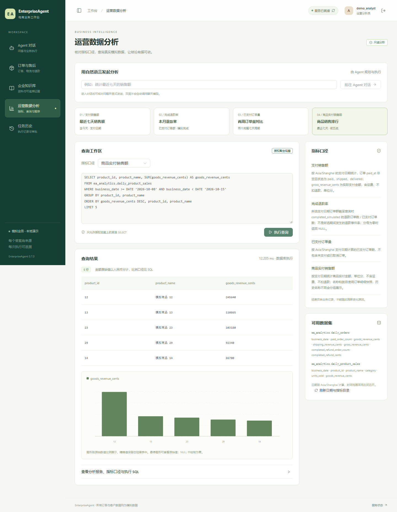
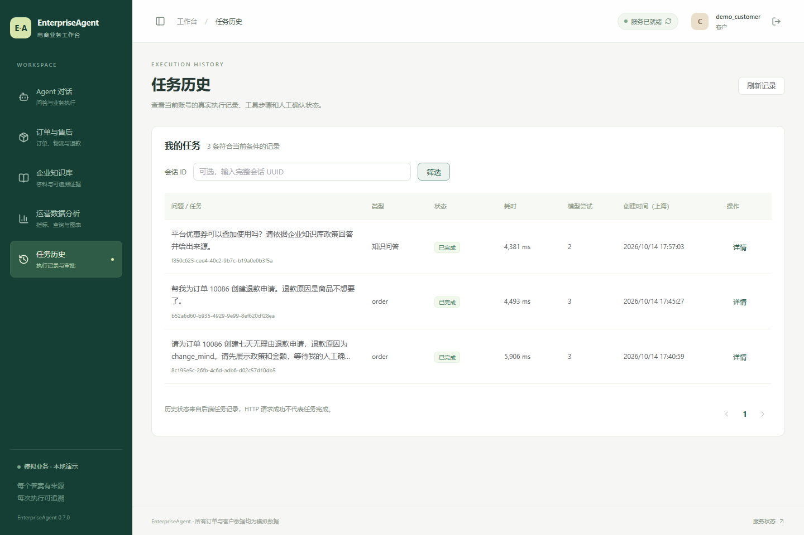

# EnterpriseAgent

基于 LangGraph、Agentic RAG 与 MCP 的企业级电商智能业务助手。项目使用虚构电商数据，以业务规则、权限、事务、可追溯检索和真实验证为重点，分阶段交付。

最近交互改进：演示密码与登录页预填值一致，知识库标题可点击弹窗查看全文，查找选项使用直白中文。实现与专项验证见[知识库交互说明](docs/knowledge-usability.md)。

**当前版本 0.9.0 / Phase 9 已完成：全栈 Docker Compose、Linux 依赖与 CI 工作流。** 新增独立本机全栈部署、API / Vue 镜像和自动化检查工作流，实际验证范围见[阶段记录](docs/phase-9.md)。已有[Phase 8 评估](evals/results/phase8/report.md)保留 **5 pass / 3 fail / 9 manual_review / 1 unobserved、39440 Token** 的原始结果；[Phase 7 浏览器证据](evals/results/phase7/report.md)及更早记录也不改写为容器部署或新模型成绩。

本机 Linux 全栈已实际构建并启动，六项依赖就绪、**13 / 13 HTTP 检查**通过，API 重建后模拟业务数据保持一致，Nginx 在 API 地址变化后恢复代理。Linux 两套依赖锁实际哈希安装通过，完整后端 **1097 / 1097**、前端 **43 / 43**，受控故障 **16 / 16**、固定 SQL **24 / 24**。新 v2 语料通过独立 CLI 执行 RAG 对照，**60 / 60 记录完成**，两种模式文档级指标相同；完成数量不表示回答语义全对。完整结果及证据边界见[验收报告](evals/results/phase9/report.md)。本阶段未发送聊天模型请求，GitHub 平台工作流尚未运行。

## 功能与技术栈

| 模块 | 当前实现 |
| --- | --- |
| FastAPI 工程 | 配置、JSON 日志、请求 ID、CORS、统一错误与健康检查 |
| 数据库与认证 | PostgreSQL 17、SQLAlchemy 2.x、Alembic、15 张业务表、Argon2、JWT、实时角色校验 |
| 订单与售后 | 查询、资格、用户确认、幂等、待审核退款、客服审核、模拟完成与审计 |
| 知识库 | PDF / DOCX / UTF-8 TXT / Markdown 上传、列表、点击标题弹窗查看完整文本、原件下载、删除、重新索引 |
| 检索 | 512 维中文 BGE、Chroma 1.5.9 HTTP、中文字符/二元组 BM25、RRF、量化 BGE Reranker |
| 来源与权限 | 页码/段落/行号/字符位置、文档与索引版本、公开/内部可见性、失效引用拒绝 |
| Agent | LangGraph 1.2.14、HTTPX DeepSeek 兼容接口、Pydantic 工具参数、有限执行、原文抽取回答 |
| 会话与审批 | 私有 thread、官方 PostgreSQL Checkpoint、多轮历史、人工 interrupt/resume、显式恢复与幂等写入 |
| MCP | 官方 SDK 1.30.0、独立 stdio Server / Client、工具发现、三个只读工具、每次调用重新认证 |
| 运营分析 | 单图 NL SQL、SQLGlot 30.22.0、独立 reader、两个聚合视图、真实查询报告和图表数据 |
| Vue 管理后台 | 五个业务页面、JWT 内存会话、按角色显示操作、Markdown 安全渲染、引用核验、人工确认与 SVG 图表 |
| 评估 | 30 条 RAG 对照、24 条固定 SQL、18 条分组 Agent 案例、16 条明确故障注入；JSON / CSV / Markdown |
| 日志与追踪 | 白名单元数据 JSONL、累计 Token/未知消费、执行片段关联、可选显式 LangSmith 摘要导出 |
| 本地部署 | Windows 开发方式与独立 Linux 全栈 Compose；外部只读模型、分离初始化权限，缓存与数据优先 D 盘 |

AI 检索使用 **真实 CPU ONNX 推理**，通过 FastEmbed 和 ONNX Runtime 运行；模型固定仓库 revision、大小和 SHA256，启动与查询不隐式下载。具体版本见 [pyproject.toml](pyproject.toml)、[哈希锁文件](requirements/) 和模型 manifest。直接知识检索与业务 API 不需要聊天模型 Key；Agent 发消息与执行恢复需配置 DeepSeek，默认 `EA_LLM_ENABLED=false`。

## 架构



业务事实与可执行政策由 Service 和 PostgreSQL 决定；检索文档不能替换身份或直接批准退款。模型只能准备服务器生成的审批摘要，人工确认后 Service 重查并创建待审核申请。审批准备绑定任务、确认使用服务端幂等键，业务提交后丢失 Checkpoint 可显式恢复。索引发布使用尝试代数与 job ID；当前没有独立 Worker 或自动领取任务。详见 [架构](docs/architecture.md)。

## 项目目录

```text
EnterpriseAgent/
├─ main.py
├─ pyproject.toml
├─ requirements/                 # Windows / Linux base/dev 版本与哈希锁
├─ .env.example
├─ src/enterprise_agent/
│  ├─ application.py             # 工厂与生命周期
│  ├─ config.py / database.py / security.py
│  ├─ api/                       # 认证、订单、退款、知识库、Agent、分析、健康
│  ├─ models/ schemas/ repositories/ services/
│  ├─ agents/                    # LangGraph / Chat协议 / PostgreSQL Checkpoint
│  ├─ tools/                     # Pydantic工具与业务Service复用
│  ├─ mcp/                       # 官方 stdio Server、Client 与只读业务适配
│  ├─ analytics/                 # 授权视图目录、SQL AST、只读查询 runtime
│  ├─ rag/                       # parsing/chunking/ranking/backends/runtime/store
│  ├─ knowledge_cli.py           # 复用 Service 索引已登记文档
│  ├─ evaluation.py              # 真实检索对照
│  ├─ evaluations/               # 严格案例合同、证据检查、SQL参考、故障注入
│  ├─ observability.py           # 本地累计元数据；可选 LangSmith 摘要
│  └─ seed.py
├─ alembic/                      # 0001_ecommerce → … → 0005_analytics
├─ data/knowledge/               # 5 篇模拟政策
├─ evals/datasets/                # RAG、人工SQL、Agent与受控故障案例
├─ frontend/                     # Vue 五页、API client、认证内存状态、组件与前端测试
├─ scripts/                      # bootstrap/init/migrate/seed/prepare/index/eval/check/run/mcp-demo
├─ tests/                        # 单元、真实 PostgreSQL、真实模型、HTTP
├─ deploy/                       # 原基础设施 + 独立全栈 Compose、API / web Dockerfile
├─ .github/workflows/            # 后端 / 前端自动化检查
├─ docs/
└─ var/                          # 本地秘密、模型、原件、缓存、报告；不提交
```

## 快速启动

Windows PowerShell 在项目根目录执行。需要 Python 3.13 虚拟环境与运行中的 Docker Desktop。首次克隆先在 PyCharm 创建项目 `.venv`；bootstrap 不安装 Python 或 Docker。

```powershell
Set-Location 'D:\Python\PycharmProjects\EnterpriseAgent'
.\scripts\bootstrap.ps1
.\scripts\init-infra.ps1
.\scripts\init-analytics.ps1
.\scripts\migrate.ps1
.\scripts\migrate.ps1 -TestDatabase
.\scripts\seed.ps1
.\scripts\prepare-rag.ps1
.\scripts\index-knowledge.ps1
.\scripts\evaluate-rag.ps1
.\scripts\check.ps1
.\scripts\run.ps1
```

首次模型准备显式下载固定版本公开文件，合计 **396,800,683 字节**；可使用可信离线副本与 `prepare-rag-models.py --offline-source`。模型推理只读取校验成功的本地文件。索引脚本处理已登记且未删除的文档，当前 fingerprint 已索引的文档会跳过。评估限定五篇种子文档，不把用户上传内容混入对照。

原生开发模式使用 Agent 前，在不提交的 `.env` 设置 `EA_LLM_ENABLED=true` 并填写自己的 `EA_DEEPSEEK_API_KEY`，随后重启 API。容器后台（15173）不读取这份 `.env`：Key 需保存在 `var/compose/secrets/deepseek-api-key`，并在 `var/compose/compose.env` 设置 `EA_FULL_LLM_ENABLED=true` 后更新 API 容器。默认 `EA_DEEPSEEK_MODEL=deepseek-flash`，显式禁用 Thinking；Key 只留后端。未配置时发消息返回 `agent_model_not_configured`，不会用测试脚本伪装模型回答。完整配置见 [部署](docs/deployment.md)。

在另一个 PowerShell 终端启动后台。需要 Node.js 24，前端依赖由提交的 `frontend/package-lock.json` 固定；不把 API Key、数据库连接或 JWT 秘密放进 Vite 配置。

```powershell
.\scripts\frontend.ps1 -Mode Install
.\scripts\frontend.ps1 -Mode Run
```

访问 [Vue 后台](http://127.0.0.1:5173)，使用下表的公开模拟账号登录。前端通过同源 `/api/v1` 和 `/health` 代理访问本机 API；首次进入页面只读取必要数据，不自动创建 Agent 任务或调用聊天模型。前端安装缓存及运行目录保留在项目 D 盘，详见[部署](docs/deployment.md)。

`init-infra.ps1` 生成并保留本地随机 PostgreSQL/JWT 秘密，启动 PostgreSQL、Redis、Chroma，并同步两个专用分析连接字段；`init-analytics.ps1` 为新旧项目库初始化受限 reader，不重置数据。秘密位于被 Git 忽略的 `var/infra/` 和 `var/infra-secrets.env`。迁移和 seed 使用初始化账号；业务 API 与分析使用各自受限账号。API 启动不自动迁移、seed、下载模型或索引。详情见 [部署](docs/deployment.md)。

项目、`.venv`、pip/TEMP/TMP、模型及报告使用 D 盘。Docker 程序位于 `D:\tools\DockerDesktop`，实际 Docker/WSL 数据盘位于 `D:\DockerData`，三个服务的数据目录位于该盘下；少量 Windows 配置可能仍位于 C 盘。

启动后访问 [Swagger](http://127.0.0.1:8000/docs)、[服务信息](http://127.0.0.1:8000/)、[存活](http://127.0.0.1:8000/health/live)、[就绪](http://127.0.0.1:8000/health/ready)。重启前可运行 `scripts/stop.ps1` 停止本项目登记并验证身份的后台进程，交互式服务用 Ctrl+C 关闭。

### 独立全栈容器启动

已准备 `var/models` 固定模型文件后，在项目根目录执行：

```powershell
.\scripts\full-stack.ps1 -Mode Prepare
.\scripts\full-stack.ps1 -Mode Up
.\scripts\full-stack.ps1 -Mode Check
```

访问 [容器后台](http://127.0.0.1:15173) 或 [容器 API 健康](http://127.0.0.1:18000/health/ready)。全栈项目 `enterpriseagent-full` 使用独立 `var/compose` 数据，不覆盖已有开发库。账号名与下表相同，默认演示登录密码为 `DemoOnly!2026`，与登录页预填值一致；本机 `var/compose/secrets/demo-password` 保存实际使用的密码，自定义密码时以该文件为准。数据库和 JWT 秘密仍独立随机生成。默认关闭 DeepSeek、Swagger 和云端追踪；需要模型时显式配置 secret 文件与 `EA_FULL_LLM_ENABLED`，详见[部署](docs/deployment.md)。

Linux 容器回归使用 `full-stack.ps1 -Mode Test`，只重置独立测试库；`-Mode Stop` 核对项目归属并停服务，保留数据。实际验收数量、镜像/权限检查与未验证范围见[Phase 9](docs/phase-9.md)，不因容器启动成功声称模型质量或 GitHub CI 已通过。

## Demo 与 API

Windows 开发公开模拟账号共用密码 `DemoOnly!2026`；全栈容器账号使用本机生成的独立密码：

| 账号 | 权限 |
| --- | --- |
| demo_customer / demo_other | 自己的订单退款、公开知识；用于跨客户拒绝演示 |
| demo_support | 订单售后、公开和内部知识 |
| demo_analyst | 公开知识、授权聚合运营分析；无订单明细权限 |
| demo_admin | 订单售后、知识库维护与聚合运营分析；用户管理 API 尚未实现 |

在 Swagger 登录，再使用 Bearer Token。知识检索：

```http
POST /api/v1/knowledge/search
Content-Type: application/json
Authorization: Bearer <token>

{"query":"已签收订单多久内可以申请退款？","mode":"hybrid_rerank","top_k":5}
```

该直接检索接口仍返回 `answer_mode=evidence_only`、引用、文档版本、Chunk 与位置和各阶段耗时；证据分数不足时为 `insufficient_evidence`。Agent 知识分支可改写一次查询，再调用模型选择原文并逐一校验，不能把相关性分数当作完整语义证明。

Agent Demo：`POST /api/v1/agent/sessions` 创建会话 → 向 `/sessions/{id}/messages` 发送 `{"message":"查询订单 10086 的物流状态"}`。退款请求得到 `waiting_approval` 后，在返回的 `result.approval` 核对订单、金额、原因与政策，再向 `/tasks/{id}/resume` 提交 `approval_id` 和明确的 `confirmed`。客户端不能提供 graph 配置、thread、用户、角色或金额；执行中断时使用 `/tasks/{id}/recover` 核对持久状态。

运营 Demo 使用 demo_analyst / demo_admin 创建自己的 Agent 会话，发送“统计最近七天的销售额”“本月退款率是多少”“对比最近两周的订单量”或“哪些商品销售额最高”。任务的 `result.analysis` 保存实际 SQL、受限结果、指标口径和图表数据。也可直接调用 `GET /api/v1/analytics/catalog` 与 `POST /api/v1/analytics/query`；直接 SQL 接口不调用聊天模型。销售额按上海支付日期统计，毛实付包含运费且不扣退款；退款率为支付日期订单群截至查询时的模拟完成退款订单数 / 已支付订单数，具体口径和请求见 [API](docs/api.md)。

MCP Demo 在 API、数据库、Chroma 和已索引知识库就绪后执行：

```powershell
.\scripts\mcp-demo.ps1
# 或选择另一条当前模拟客户拥有的订单
.\scripts\mcp-demo.ps1 -OrderNo '10086'
```

脚本使用公开模拟客户在 loopback API 登录，官方 Client 启动独立 stdio 子进程，发现并调用 `query_order`、`query_logistics`、`query_refund_policy`；JWT 只经子进程环境传递，不作为命令行参数或输出。已有 Token 的集成可设置进程环境 `EA_MCP_ACCESS_TOKEN` 后运行 `python -m enterprise_agent.mcp.client`，具体运行环境与参数见[部署](docs/deployment.md)。每个 Server 进程对应一名用户；Token 过期需重新登录并重启，不提供 HTTP/OAuth 服务。退款仍由现有人工确认工作流创建。

退款 Demo：查询订单 → `refund-preview` → 人工核对 → `POST /refunds` 明确确认与幂等键 → 客服审核 → 模拟完成。仅创建和管理模拟记录，不调用支付平台。订单 `10086` 属于 demo_customer，商品实付 12900 分、运费 800 分；标准政策不退运费。

seed 默认当天 UTC 基准、随机种子 42、500 订单；本工作区使用 2026-10-12 的固定数据。API 用当前 UTC 判断期限，数据会随时间超期；重复 seed 不覆盖已有数据。业务测试注入固定时钟。

Vue 后台提供五个业务页面：

| 页面 | 实际交互 |
| --- | --- |
| Agent 对话 | 新建/选择持久会话、显式发送、按 `Task.status` 显示回答和失败、步骤/用量/来源、确认与恢复 |
| 订单与售后 | 当前账号可见订单、商品/物流/资格，客户核对退款，客服/管理员审核及模拟完成 |
| 企业知识库 | 可见文档与下载、三种检索模式、来源核验；管理员上传、删除、重新索引与错误状态 |
| 运营分析 | 授权目录、四个只读 SQL 模板、手动查询、精确原始结果、SVG 图表、指标口径；自然语言只预填 Agent 草稿 |
| 任务历史 | 自己的分页任务、会话筛选、执行详情和关联会话跳转 |

登录 Token 只保存在页面运行时内存，刷新页面需重新登录。前端角色显示不授予权限，所有访问和修改继续由后端验证。真实浏览器连接专用本机测试库、真实 CPU 检索和配置的聊天模型；截图来自实际页面，使用虚构数据。完整接口见 [API](docs/api.md)，浏览器执行范围见 [Phase 7](docs/phase-7.md)。

### 实际 Demo 截图

Agent 对话展示已保存的多轮任务、实际回答、工具步骤和知识来源：



订单与售后展示当前账号的订单、物流、退款资格和人工核对入口：



企业知识库展示已索引文档与真实检索；维护操作仍受管理员权限和政策来源保护约束：



运营分析展示实际只读查询、精确原始值、指标口径和 SVG 图表：



任务历史展示当前账号的持久化任务与执行详情：



[退款提交回执](docs/screenshots/phase7/approval.png)、[来源核验](docs/screenshots/phase7/citation.png)与[自然语言分析结果](docs/screenshots/phase7/agent-analytics.png)另行保留。截图为真实页面，历史回执展示申请提交时状态；最新退款审核结果在订单页读取。截图仅证明对应本机运行状态，不代表公网部署、性能或开放式模型质量。

## 测试与 Evaluation

Phase 9 在实际 Linux 容器中完成完整后端 **1097 项通过，0 失败/错误/跳过**，强制真实 PostgreSQL / RAG；JUnit 621.404 秒、控制台 624.08 秒，87 条 Chroma 弃用警告保留。Ruff、150 文件格式、pip check 与固定模型校验通过；同一检查链随后完成受控故障 **16 / 16**、固定 SQL **24 / 24**，两类评估各自统计，不加到 pytest 总数。Linux 前端 **43 / 43（6 文件）**、格式、严格类型、构建及生产依赖 audit 通过，生产漏洞 0。前三轮失败和不完整执行保留，详见[Phase 9](docs/phase-9.md)。

Phase 8 将机器可核对的任务状态、工具参数、订单归属、当前引用和精确 SQL 行与人工语义判断分开。18 条 Agent 案例由开发助手依据项目代码和模拟语料编写，包含 development、历史失败 regression 和本阶段新问题 validation；新问题冻结不等同外部独立标注或盲评。没有人工语义标签时保留 `manual_review`，不能按成功计入语义质量。16 条受控故障案例运行实际 LangGraph 与参数校验，模型/Service/内存 Checkpoint 为明确测试输入，不能当作线上模型、PostgreSQL 或真实退款成绩。执行协议见[评估](docs/evaluation.md)及[本阶段记录](docs/phase-8.md)。

默认启用的本地追踪只记录 Task UUID、状态、白名单节点/工具名、安全错误码、耗时和累计 usage。文件位于 `EA_DATA_DIR/observability/agent-traces.jsonl`，不得跨 resume/recover 快照直接相加 Token。可选 LangSmith 使用显式 `EA_LANGSMITH_*` 配置，默认关闭；本阶段没有云端凭据或真实云导出验收，不自动上传问题、答案、工具参数、SQL、文档或个人字段。步骤是执行后的累计快照，不是实时 span 时序，详见[部署配置](docs/deployment.md)。

本次真实在线运行的 17 个 Task 对应 17 条本地快照，白名单字段以及 request hash、状态、错误和累计 usage 与 DTO 匹配；快照中的 39440 Token/36 次调用属于同一线上账本，不能再次加到消费总量。验证记录见[追踪证据](evals/results/phase8/observability/verification.json)，它不是网络抓包或 LangSmith 远端连接证明。

先准备专用测试库与真实本地检索，再显式运行付费模型评估：

```powershell
.\scripts\evaluate-phase8.ps1 -Mode Prepare
.\scripts\evaluate-phase8.ps1 -Mode Live -AllowLive -Prepared
```

`Prepare` 保留已有虚构测试数据，不重置库；`Live` 启动隔离 `127.0.0.1:8002` API，每轮写新的 UTC 目录，并保留失败与待复核结果。它只准备退款预览，不自动确认。退出码成功表示执行/记录完成，不代表模型质量全部通过；配置与原始产物说明见[部署](docs/deployment.md)和[Phase 8](docs/phase-8.md)。

```powershell
.\scripts\check.ps1
.\scripts\evaluate-rag.ps1
.\scripts\frontend.ps1 -Mode Check
.\scripts\evaluate-phase8.ps1 -Mode Boundaries
```

Phase 8 完整后端回归 **1034 项通过，0 失败/错误/跳过**，强制真实 PostgreSQL/RAG，JUnit 712.590 秒；87 条 Chroma 弃用警告保留。之后修正评估 SQL 参照与物流选样，最终专项 **112 项通过，JUnit 2.898 秒**；此前 104 项专项保留，没有重跑完整套件或将子集累加。前端 **43 项/6 文件**、严格类型、构建及生产依赖 audit 通过；构建 516 ms 为单次观察，984.49 kB UI chunk（gzip 316.59 kB）的警告仍在。最新修复范围与测试证据见[验收报告](evals/results/phase8/report.md)。

Phase 8 真实本地 RAG 对照重新执行 60 条模式记录，test 文档级 Recall@3 从 **0.970588 → 1.000000**，nDCG@5 从 **0.977244 → 1.000000**，平均耗时从 **38.298 → 966.886 ms**。这是开发已接触的历史 QA 集和单次本机观察，增益同时伴随时延，不声称盲评或性能优化。独立基表 SQL 对照 **24/24**，受控故障期望 **16/16**，两者均无供应商调用。各层结果与边界见[评估](docs/evaluation.md)。

Phase 8 在线首次冻结运行的 validation 13 条为 **4 pass / 2 fail / 7 manual_review**。复杂退款未准备审批、优惠券知识任务规划失败、退款“比例”与 oracle 百分比口径歧义均保留；首条物流在消息前因为选到无物流订单失败，没有模型调用。双周比较返回两行，值与独立参考一致但 judge 未识别其映射，保留复核。评估器缺少原始模型参数和人工语义标签，不伪填任务完成率；17 个实际 Task、36 次实际尝试、prompt 35626 / completion 3814 / total **39440 Token**，消费完整。冻结结果未因后续评估器修复改分或复跑，详见[在线结果](evals/results/phase8/live/report.md)。

check默认传`--require-postgres --require-rag`，执行Ruff、格式、pytest与pip check。Phase 4初验**511项通过、0失败/错误/跳过**，JUnit524.068秒、81条Chroma弃用警告保留；真实Uvicorn重启后仅创建一条退款和工单。初验主服务五项健康通过，尚未配置模型时503且零任务。[验证摘要](evals/results/phase4/verification.json)、[重启](evals/results/phase4/http-restart.json)和[主HTTP](evals/results/phase4/demo-http.json)保留原始`online_deepseek_tested=false`。在线修复后110项核心测试通过，[517项完整复验通过](evals/results/phase4-live/verification.json)；历史初验不冒称最新代码验收。

Phase 5 新增官方 MCP 工具发现、严格参数、逐次 SQL 认证、越权/撤销/角色变化、错误脱敏及真实 stdio 子进程测试。真实 PostgreSQL、CPU 模型和 Chroma 用于政策检索；检查退款、工单和审批数量不变，stdout 仅含 JSON-RPC，SDK 退出后实际子进程结束。[实际 Client Demo](evals/results/phase5/mcp-demo.json)完成三工具读取；[主服务 HTTP](evals/results/phase5/demo-http.json)为 0.5.0 / phase=5、五项就绪通过。完整检查 **614 项通过、0 失败/错误/跳过**，JUnit 548.312 秒，85 条 Chroma 弃用警告保留，Ruff / 格式 / pip check 通过。本阶段未调用云模型，不能据此推导模型意图或任务完成率。[完整摘要](evals/results/phase5/verification.json)、[实际协议证据](evals/results/phase5/mcp-stdio.json)与[可读报告](evals/results/phase5/report.md)已归档，详见[Phase 5](docs/phase-5.md)。

Phase 7 的 **43 项前端单元/组件测试与 21 项 API 回归通过**，严格 TypeScript、格式检查、Vite 构建和生产依赖 audit 通过。真实 Edge 连接专用本机 API 完成 **1 条串行全流程、14 个检查点**，覆盖五页、跨客户拒绝、退款确认/审核/模拟完成、真实知识检索与维护、只读查询及持久任务。受控组件测试和真实浏览器证据分开记录，详见[验证报告](evals/results/phase7/report.md)。

最终通过流程观察到三个唯一 Task、七次模型调用尝试、累计 **8844 Token**；其中 **5232 Token** 来自前一轮已持久化的待审批任务，实际通过轮新增 **3612 Token**。连同失败轮次按 Task ID 去重，Phase 7 共四个 Task、十次尝试、prompt 13129 / completion 1231 / total **14360 Token**，没有未知消费。首次登录选择器失败没有提交模型消息；另一轮多意图退款请求只完成政策查询而未准备审批，失败保留。三个引导式任务用于开发验收，不据此声称模型任务完成率或泛化正确率。

如需重新执行真实浏览器业务流程，先完成本机基础设施、迁移及模型配置，再显式接受在线模型调用：

```powershell
.\scripts\verify-frontend.ps1 -AllowLive
```

该脚本仅操作专用 `enterprise_agent_test` 中的虚构业务记录，真实供应商调用可能消耗余额；不重置开发库，不创建云资源。测试数据随时间超期，需核对数据日期和退款期限。普通前端 Check 不触发聊天模型调用。

Phase 6 最终完整检查 **883 项通过、0 失败/错误/跳过**，强制真实 PostgreSQL / RAG；JUnit 697.865 秒、CLI 697.89 秒，Ruff lint / 153 文件格式 / pip check 通过。85 条 Chroma legacy embedding function config 弃用警告保留，未声称修复。[完整摘要](evals/results/phase6/verification.json)、[143 个选定源码/脚本/测试/锁/数据集的稳定哈希](evals/results/phase6/source-freeze.json)与[可读报告](evals/results/phase6/report.md)已归档；首轮 878/879 的失败及修复保留，122 项聚焦子集不重复累计。

[固定 SQL 对照](evals/results/phase6/sql-report.md) **24/24 通过**：16 条人工 SQL 与独立基表事实匹配、8 条安全输入按预期拒绝；不是 NL SQL 正确率。500 订单、1016 明细、19 退款的数据指纹前后稳定，模型调用为零。[HTTP 记录](evals/results/phase6/http.json)为最终 0.6.0 / phase=6、六项就绪、直接 SQL 返回 991510 分、宽数值表两条 series，以及客户 403 / 原始表 SQL 422；零模型调用仅属于该直接接口快照。

[真实在线烟测](evals/results/phase6/live-report.md)为 4 个手选、明确输出合同的运营场景，**4/4 检查通过**；真实 Agent / reader 查询逐列逐行与 canonical API 对照，8 次模型调用、prompt 7427 / completion 1019 / total **8446 Token**，无未知消费。标签 deepseek-flash 由操作者提供，Task DTO 不暴露供应商真实身份；这不是盲评、泛化正确率或性能基准。该记录早于最后两项边界修复，最终代码对归档结果的离线复核仍为 4/4，新增模型调用 0；不将离线复核冒充新一轮在线调用。完整边界见[Phase 6](docs/phase-6.md)，历史检索与在线失败轮次不覆盖。

真实在线补充见[烟测报告](evals/results/phase4-live/report.md)与[最终JSON](evals/results/phase4-live/results.json)：手选5场景最终检查5/5通过（其中越权场景按预期失败），12次模型调用、12190个已知Token。首探针与三轮失败也完整保留，所有在线轮次累计45443个已知Token、46次调用。样本用于开发修复，不是盲评、完整模型质量或性能基准；详见[阶段记录](docs/phase-4.md)。

Phase 3 完整检查 **309 项通过、0 失败/错误/跳过**，Ruff lint/格式 89 文件与 pip check 通过；真实 TCP 知识库流程 15 项通过。测试套件 327.041 秒，不是 API 性能。官方 SDK 的 51 条 DeprecationWarning 未屏蔽，已归档 [检查摘要](evals/results/phase3/verification.json) 和 [HTTP 验收](evals/results/phase3/http.json)，限制见 [Phase 3 验收](docs/phase-3.md)。Phase 1 的 75 项与 Phase 2 的 191 项保留历史记录，不累计成新指标。

评估集 **30 条，25 可回答 + 5 无证据；dev=10、test=20**。已归档 [最终真实对照](evals/results/phase3/report.md)：test 两组 R@5/MRR/nDCG@5 均为 1，3 条无证据问题均拒绝；vector mean/P95 为 38.529/42.376 ms，hybrid_rerank 为 1008.561/1136.540 ms。混合重排在这个小语料上没有改善文档级指标，延迟更高。初轮暴露门控问题，查看 test 后修正为双门槛；[初轮结果](evals/results/phase3-initial/report.md) 保留，这属于 QA 修正，不能称盲评。运行结束核对源码、数据与模型 manifest hash 稳定；耗时是本机单次观察，不是受控性能基准。生成模型实际调用和输入/输出 Token 均为 0，本地模型 API Token 统计为 N/A。详见 [评估](docs/evaluation.md) 与 [协议](evals/README.md)。

## 技术特点

- 数据库事实、结构化政策与检索解释分离；新知识文档不会自动改变退款规则。
- 订单归属、实时角色、JWT 撤销、确认摘要、行锁、幂等及同事务审计。
- 已发布政策及来源文档由 PostgreSQL trigger 保护；允许重索引，禁止删除或替换来源。
- 向量候选与中文 BM25 通过 RRF 融合，真实量化 Reranker 重排，模型来源可复现。
- SQL 可见性与活动代数在检索前后校验，跨库索引发布有明确失败与并发边界。
- 真实模型、数据库、HTTP 与评估结果分别验收，不用控制流程替身冒充模型效果。
- Agent 身份通过可信 Context 注入；模型只能计划，Service 始终检查归属与业务规则。
- 任务关联审批、服务端幂等确认、线程 advisory lock 与显式恢复共同处理跨库提交边界。
- 原文抽取校验与确定性业务报告，记录工具步骤、实际报告的 Token 和未知使用量。
- MCP 只适配协议入口，严格参数、实时身份和业务归属复用现有 Tools / Service；通过实际子进程验证协议与退出。
- 分析 SQL 在专用 reader 上执行，AST 只接受单个授权视图；金额保留精确十进制，报告来源可逐行核对。
- 前端将 HTTP 成功、Agent 完成与知识索引完成分别显示；不确定的业务提交先核对服务器，再按原审批和幂等键决定是否手动重试。

## 阶段交付

| 阶段 | 内容 |
| --- | --- |
| Phase 9（已完成） | 应用/前端镜像、全栈 Compose、GitHub Actions 工作流、本机 Linux 验证；平台 CI 尚未运行，实际边界见阶段记录 |

原九阶段开发计划已完成。后续维护优先在指定 GitHub 仓库实际运行 CI，并用独立问题和人工语义标签复核保留的模型失败与待复核案例；当前不自动推送、发布或增加新阶段。设计依据见 [工作流](docs/agent-workflow.md) 和 [技术决策](docs/technical-decisions.md)。

## 已知限制

- 使用虚构电商数据，未连接真实企业、支付退款或公网部署。
- 首版整单退款、一单一包裹，没有部分退款、拆单物流或退货寄件。
- PDF 只读已有文本层，无 OCR；DOCX 覆盖正文与表格，不包含页眉页脚、修订文本及文本框；TXT/MD 仅 UTF-8。
- 默认 Chunk 为 500 **字符**、重叠 80；模型输入上限 512 Token，字符不等于 Token，较长内容会被模型截断。
- 本地 CPU 推理、同步请求/CLI 索引，不是独立持久队列或高吞吐生产服务；向量清理失败可能留下旧条目，未知数据库提交结果可能留下未登记原件，没有自动清理工具。
- Agent 评估仍为小型自编模拟问题集，无外部独立标注或完整模型质量/负载评估；结构忠实度与问题语义充分性分别报告，当前 9 条复核和 1 条未观察案例不算通过。
- 本地追踪为累计元数据快照，没有日志轮转或跨进程文件锁；LangSmith 摘要导出默认关闭，尚无真实云端验收，队列满或发送失败可能丢弃摘要。
- 分析仅支持一个授权聚合视图上的受限 SELECT，不支持 JOIN、CTE、子查询、窗口函数或自由数据源。AST 证明执行边界，不能证明模型选择了正确指标或时间范围。
- 图表只展示前 30 行的相对数值和原始值悬停提示，完整受限结果见表格；截断结果不能作为完整总量，指标口径与执行 SQL 都需要核对。
- MCP 仅本机 stdio、每进程一个 JWT 身份、三个只读工具；没有网络 MCP/OAuth、Token 自动续期或 Agent 图内 MCP 调用分支。stdin 来自可信本机 Client，尚未提供恶意大帧内存隔离或生产负载评估。
- 知识回答为可追溯原文抽取，能限制文字编造，但不能证明选段语义足够或已识别所有政策冲突。
- Agent 通过请求同步执行、人工等待持久化，不提供流式 UI、独立 Worker、自动任务重领或自动恢复调度。
- 保留 Windows 开发方式与独立全栈 Compose；本机容器检查不等同公网配置、生产部署或 GitHub 平台 CI 已运行。
- 小型人工数据集与分数门控不能代表开放式回答语义可靠性。
- 公开演示账号与 loopback 服务不能直接作为公网配置。
- 前端 JWT 与未决退款的原审批/幂等键只存运行时内存；无自动 Token 续期，刷新或关闭页面后需重新登录并从后端核对记录。
- 历史在线流程的多意图退款提示出现只查询政策、未进入审批的情况；更明确的单一请求通过。该失败仍待更大独立任务/工具评估，不将改写提示算作通用解决。
- Vite 构建保留 UI chunk 超过 500 kB 的警告，本次 minified 约 984.49 kB、gzip 316.59 kB；尚未完成组件按需引入优化或独立页面加载性能测试。

## 文档与许可证

[架构](docs/architecture.md) · [API](docs/api.md) · [Agent 工作流](docs/agent-workflow.md) · [Evaluation](docs/evaluation.md) · [部署](docs/deployment.md) · [技术决策](docs/technical-decisions.md) · [Phase 1](docs/phase-1.md) · [Phase 2](docs/phase-2.md) · [Phase 3](docs/phase-3.md) · [Phase 4](docs/phase-4.md) · [Phase 5](docs/phase-5.md) · [Phase 6](docs/phase-6.md) · [Phase 7](docs/phase-7.md) · [Phase 8](docs/phase-8.md) · [Phase 9](docs/phase-9.md)

代码采用 [MIT License](LICENSE)。
