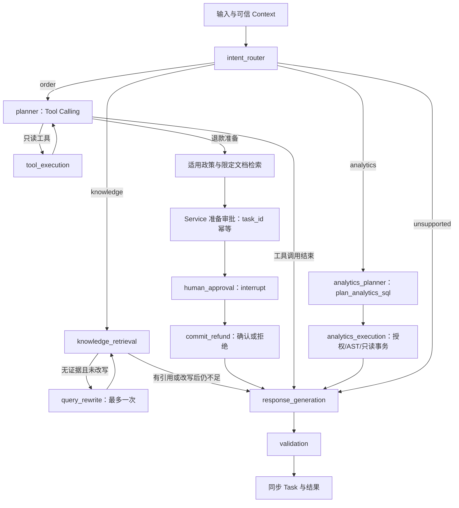

# LangGraph 工作流

当前 Phase 6 / 0.6.0 使用一张 LangGraph 图，复用 OrderService、RefundService、KnowledgeService 和 AnalyticsService。模型负责路由、工具规划、有限检索改写、引用原文选择与受限 SQL 规划；后端决定权限、业务规则、确认和实际执行。分析分支不拆成第二个 Agent，也不增加自由文本模型报告节点。当前验收见[Phase 6](phase-6.md)，[Phase 4](phase-4.md)及[Phase 5](phase-5.md)的原始验证保持历史边界。

## 当前图

POLICY/PREPARE 是 tool_execution 内部步骤，不是额外独立 Agent。analytics_planner / analytics_execution 是当前图节点。各节点失败按安全错误终止；没有 MCP 图分支，unsupported 明确说明当前范围。

## State、Context 与持久化

State 保存 task_id、用户消息、意图、查询、历史、模型消息、工具计划与结果、引用、服务器审批、退款结果、analysis、步数、工具次数、改写次数、steps、usage、状态、回答和 warning_codes。analysis 为真实查询结果、图表规范及指标定义；持久化后同步到 Task.result.analysis。

Principal、Service、模型和配置放在可信 AgentContext。State 中的订单用户字段仅为业务事实，不能用来决定认证；模型不能提供 user_id、role、权限或 graph config。session/thread 由后端产生，HTTP 仅接受会话和任务 UUID，所有角色都只能查询自己的会话、任务和确认记录，当前角色还须匹配不可变创建角色；角色变化需新会话，恢复原角色后可访问原合法会话。

AgentService 使用官方 AsyncPostgresSaver 保存图状态。0003_agent 管理 ea_checkpoint schema 和对应 SDK 版本，运行账号没有 DDL、schema CREATE、检查点 DELETE 或版本表修改权限；启动不调用 saver.setup()。序列化禁用 pickle fallback 和任意类重建。参见 [LangGraph 持久化](https://docs.langchain.com/oss/python/langgraph/persistence)。

每个 thread 使用 PostgreSQL advisory lock 排除并发 worker；短事务登记当前任务，执行图时不持有业务行锁。待确认任务也阻止同一会话开始新任务。人工等待作为持久化中断保存，等待期不占用 HTTP 请求、执行预算或 thread 锁。没有 Worker、自动任务重领或自动恢复调度。

## 业务工具

| 工具 | 当前行为 |
| --- | --- |
| get_order | 数据库订单状态和整数分金额，Service 校验角色与归属 |
| get_order_items | 交易商品、类目、数量及金额快照 |
| get_logistics | 数据库物流状态和已有事件，不推断缺失动态 |
| get_refund_policy | 付款时适用的结构化政策与事实判断，再仅检索 policy.document_id |
| create_refund_request | 只准备服务器审批摘要；图必须先检查政策证据，不直接创建退款 |
| get_refund_status | UUID 直查；订单号先验证归属，再在最多 2000 条授权记录中找最新申请，超限明确要求 UUID |
| search_knowledge | 真实混合检索与相关性门槛，保留权限、当前版本及来源 |

工具参数采用 Pydantic strict + extra forbid。Agent 订单号为 5–30 位 ASCII 数字；退款 reason 为 change_mind / quality_issue / not_received，notes 最长 500 字符。模型不能传入 amount_cents、approval_id、confirmed、idempotency_key、task_id 或身份。支持普通业务 API 的安全标识格式不意味着 Agent 工具也接受同样格式。

prepare_refund 的 task_id 由服务端可信上下文提供；同任务同参数重放审批，参数变化拒绝。execute_confirmed_refund 是可信确认入口，不出现在模型 tool schema 中；确认和拒绝都复用现有事务、摘要、归属、期限、审计及幂等规则。

## 知识与业务回答

知识分支先检索，证据不足只允许改写一次；仍不足直接说明不能确认。回答候选排除只含标题的Chunk，模型调用select_knowledge_quotes返回0–3段连续原文；候选不能回答原始问题时允许空列表拒答。选段仍须来自有效Chunk，权限、文本和当前代数通过校验后才构造回答。它不是完整语义蕴含或政策冲突检测，也没有调整RAG分数门槛。

订单分支仅采纳Service结构化事实，确定性报告展示订单、商品、物流、资格和申请状态。Router结合完整历史解析本轮query；业务planner仅接收original_request、resolved_query与本轮工具消息，旧答案不进入planner，避免复用历史回答跳过本轮事实查询。最终自由文本不成为业务结论；退款准备仍需数据库资格和对应政策文档证据。

## 运营分析分支

intent_router 使用完整私有会话历史解析本轮指代，返回 analytics 意图；进入规划器前 AnalyticsService 校验可信 Principal 的当前 analyst / admin 角色。规划提示只包含本轮 original_request、resolved_query 和受控 catalog：两个视图的合法字段、指标口径、上海业务日期及服务端窗口。历史结果不能代替本轮数据查询。

模型通过 named `plan_analytics_sql` 返回一个 SQLPlan：sql、metric_ids 和可选 label。参数经 Pydantic strict / extra forbid 校验，只允许一个规划调用。它不是直接执行 SQL 的权限凭据；analytics_execution 重新检查角色，由专用 reader runtime 做 AST 白名单、只读事务、超时、行数与负载限制。合法模型 SQL 仍可能在指标或时间上不符合问题，工程安全检查不替代这类语义评估。

执行结果保存 normalized_sql、columns、精确 rows、row_count、truncated 和 elapsed_ms。AnalyticsService 仅从这些行和登记口径构造 Markdown 与 query_rows 图表规范，response_generation 采用此报告，不追加自由文本 LLM 分析。validation 重新校验 QueryResult 和指标，再渲染并比较报告、analysis 与本轮执行事实；失败不能显示为成功结果。只读分析不经过 human_approval，不修改订单/退款，使用原有官方 Checkpoint、Task 和执行预算。

steps 记录 SQL 规划和 execute_analytics_sql 的安全状态、耗时与错误；usage 包含路由/规划器实际供应商报告的 Token，不把本地 SQL 或确定性报告计作模型调用。无结果、NULL 分母和截断均保留，不推断缺失销售额、未返回部分总量或业务变化原因。`result.analysis.chart` 仅为后续前端的数据协议，尚无可交互图表。

## 人工确认与恢复

退款审批卡片包括服务器产生的 approval_id、订单号、整数分金额、原因、notes、有效期、适用政策与 requires_confirmation=true。任务状态为 waiting_approval 时，尚未创建退款或售后工单。

认证客户端向 tasks/{id}/resume 发送 approval_id 和 JSON 布尔值 confirmed。API 校验任务所有者、当前 thread、待确认节点和服务器审批绑定后，构造 Command(resume=...)。客户端不能指定恢复节点或修改审批金额、政策、订单和原因。confirmed=false 记录拒绝并结束；true 重新检查实际事实、期限、摘要与活动退款后创建 pending_review 申请和工单，尚未完成支付退款。

human_approval 在 interrupt 前没有业务副作用，因为恢复会重新执行该节点；提交放在单独 commit_refund。准备按 task_id 绑定，确认使用服务器固定任务幂等键，退款、工单、幂等和审计同事务提交。参见 [LangGraph 中断](https://docs.langchain.com/oss/python/langgraph/interrupts)。

业务事务与 Checkpoint 没有共同提交。请求取消可能发生在业务已提交、图尚未记录节点结果时；recover 从官方持久状态继续，同一审批或退款通过数据库记录重放，避免额外记录。失败恢复需要用户显式调用，不能把网络超时直接当作退款未创建。对已完成任务重复相同确认返回原任务，改变决定被拒绝。

业务提交后旧引用失效只清除无效显示引用并加入 warning_codes，保留真实已提交申请结果；未提交回答引用失效则终止。敏感操作预先保留人工确认、提交、报告及校验步数，避免预算耗尽后误报已提交业务。

## 有限执行与记录

| 配置/限制 | 默认值 |
| --- | --- |
| EA_AGENT_MAX_STEPS | 24，配置 6–60 |
| EA_AGENT_MAX_TOOL_CALLS | 8，配置 1–16；自动政策查询也计入 |
| 查询改写 | 最多 1 次，代码固定 |
| EA_AGENT_MAX_RETRIES | 2 次重试，配置 0–2；即每次调用最多 3 次尝试 |
| EA_AGENT_MODEL_TIMEOUT_SECONDS | 30 秒 |
| EA_AGENT_TIMEOUT_SECONDS | 90 秒，每次主动 send/resume/recover 执行预算 |
| EA_AGENT_MODEL_MAX_TOKENS | 1024 输出 Token 上限 |
| EA_AGENT_MAX_HISTORY_MESSAGES | 12 条，保存完整问答对 |
| 审批有效期 | 30 分钟，RefundService 控制 |

只重试明确临时模型连接/限流/超时错误，退避有限。角色拒绝、非法参数、政策不符合、不可用证据和拒绝确认不当作临时网络错误重试。模型 HTTP 请求/响应最多 256 KiB，单次最多 4 个 Tool Call，工具 JSON 参数最多 16 KiB；业务执行仍受总步数、次数和预算控制。

steps 记录节点、业务工具名、耗时和安全错误；usage 累计实际供应商报告的 prompt/completion/total Token。供应商没有报告 usage 的失败增加 unknown_usage_calls，usage_complete=false，不能把未知消费写成真实零消费。执行中断可能还有尚未写入 Checkpoint 的未知消费；该不完整标记跨 recover 保留，恢复成功不能把未知消费重写为完整零消费。Task 保存结果、错误与累计执行耗时；本机检索的 Embedding/Reranker 计费 Token 为 N/A。

## 模型配置与边界

HTTPX 发送 OpenAI 兼容 Chat Completions，校验消息、工具白名单、JSON 参数、finish_reason 和 usage，不安装 OpenAI SDK 或跟随重定向。默认 deepseek-flash，thinking.type=disabled、temperature=0、非流式。route_task、rewrite_query、select_knowledge_quotes 和 plan_analytics_sql 控制节点使用 named tool_choice，业务工具仍为 auto。[DeepSeek API 契约](https://api-docs.deepseek.com/api/create-chat-completion/)为协议来源。

EA_LLM_ENABLED模板默认false；未配置时不创建真实聊天Client，发消息503。图回归测试中的ScriptedChatModel与[真实在线补充](../evals/results/phase4-live/report.md)分开记录。5个手选烟测用于发现和修复问题，不证明开放式意图、参数与语义质量。

Phase 5 的独立 stdio MCP Server 已复用 BusinessTools 的 get_order、get_logistics、get_refund_policy，提供 query_order、query_logistics、query_refund_policy。客户端发现和调用由官方 SDK 执行；身份由 MCP 启动环境中的 JWT 逐次认证，协议参数不进入 AgentContext 或图 State。当前图仍无 MCP 分支，退款准备和确认继续使用已有可信工作流，详见[Phase 5](phase-5.md)。

分析仅访问 ea_analytics 的聚合数据。MCP 仍仅复用普通业务工具，独立 Client / Server 排除分析凭据并关闭分析 runtime；不会将模型产生的 SQL 经 MCP 转发绕过分析检查。
