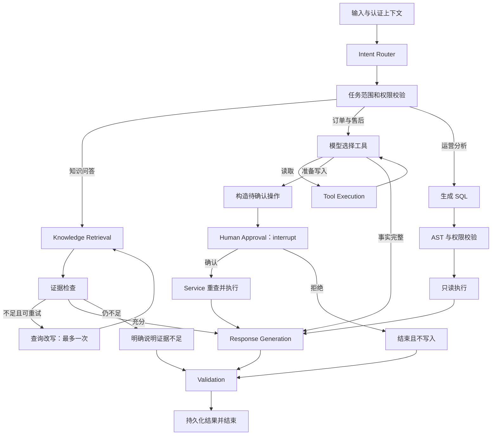

# LangGraph 工作流设计

**当前 Phase 1 尚未实现 LangGraph、Tool Calling、Checkpoint、RAG 或人工确认。** 本文件记录 Phase 4 的实现合同，以及 Phase 3 / 5 / 6 与其对接的边界。

## 单 Agent 多工具

采用一张图处理知识问答、订单售后和运营分析。通过 Intent Router 选择分支，不为了技术展示拆分多个 Agent。业务权限由后端检查，路由结果不授予额外权限。

## State 与任务记录

图状态计划包含：

- 任务 ID、会话 ID、可信用户上下文与 thread ID。
- 当前消息、意图、已执行工具调用及结构化结果。
- 检索证据的文档、版本、Chunk 和位置。
- 待确认操作、审批记录引用和执行结果。
- 执行步数、工具次数、重试次数、时间预算。
- 模型实际 Token 使用、耗时和安全错误摘要。

`agent_sessions` 绑定会话所有者；`agent_tasks` 保存任务摘要、状态与步骤。LangGraph PostgreSQL Checkpointer 保存恢复所需状态。HTTP 客户端不能指定另一个用户身份，也不能自由访问别人的 thread ID。

初期同一线程串行执行。Worker 用租约领取任务，超时租约可恢复。等待用户确认时持久化中断并释放 Worker，不占用 30 分钟的运行资源。

## 工具合同

| 工具 | 作用 | 限制 |
| --- | --- | --- |
| `get_order` | 获取订单事实 | 必须验证归属和角色 |
| `get_order_items` | 获取交易快照和数量 | 复用订单归属检查 |
| `get_logistics` | 获取真实模拟数据库物流 | 无记录时返回明确状态 |
| `get_refund_policy` | 获取适用政策版本及来源 | 不把通用检索文本当可执行规则 |
| `create_refund_request` | 创建待审核退款和工单 | 必须消费有效确认，事务重查、幂等、审计 |
| `get_refund_status` | 获取申请和审核进度 | 不暴露其他用户申请 |

工具名限定白名单，参数由 Pydantic 校验。工具结果采用结构化数据和明确错误；Agent 只能展示 Service 返回的申请状态。不存在“直接把订单改为已退款”的 Agent 工具。

模型选择读取工具后执行；写入工具被工作流拦截为待确认操作，确认后才执行。Tool Calling 中的 `user_id`、授权信息和审批权限不能由模型生成。

## 人工确认与恢复

退款确认卡片展示订单、金额、原因、政策来源和提交结果。后台保存 `approval_requests`，绑定确认人、任务、thread、操作快照、参数摘要与有效期。

用户确认后，服务端验证所有者、有效期和摘要，构造 `Command(resume=...)`。拒绝、过期或参数变化均不能继续写入。修改订单、金额或原因需要生成新的确认内容。

LangGraph 恢复时可能重新执行中断所在节点，因此副作用放在独立节点，并通过数据库幂等记录保护。业务事务可能已经提交，而图 Checkpoint 尚未保存；恢复时应找到原结果，不能再创建退款或重复工单。

参见 [LangGraph Interrupts 官方文档](https://docs.langchain.com/oss/python/langgraph/interrupts)。实现阶段锁定具体依赖，并通过实际故障用例验证。

## 有限执行

初始限制在配置中暴露，对应测试必须验证终止分支：

| 限制 | 初始值 |
| --- | --- |
| 图节点步数 | 12 |
| 工具调用次数 | 8 |
| 检索查询改写 | 1 |
| SQL 修复 | 1，修复后重新通过安全检查 |
| 临时网络重试 | 最多 2 次 |
| 单次模型请求 | 30 秒 |
| 单轮主动执行 | 90 秒 |
| 确认有效期 | 30 分钟 |

这些值是初始设计，当前不是已测性能。权限拒绝、非法参数、政策不符合和用户取消不做网络式重试。数据库写入重试仍须幂等，不能因模型或网络失败扩大申请次数。

## 证据与响应验证

知识问答先检查检索证据；允许有限改写，仍不足时明确说明。订单退款判断同时包含数据库事实和有效政策，关键金额由 Service 计算。

Validation 计划检查引用是否存在、文档版本是否有效、用户是否有访问权、关键订单字段是否对应工具结果，以及业务写入是否已经实际成功。它不等同于对开放式文本的完整事实证明，语义支持程度需要 Evaluation 与人工抽查。

检索到的文档和工具数据都是任务数据，不能覆盖 system 指令、追加未经授权工具或绕过人工确认。失败结果不包装成任务成功。

## DeepSeek 接入

接口地址、模型和 Thinking 选项配置化，通过 OpenAI 兼容接口接入。先验证非 Thinking 工具调用路径，不依赖 Thinking 模式中不受支持的强制工具选项。具体限制以实现时的 [DeepSeek Chat API](https://api-docs.deepseek.com/api/create-chat-completion/) 和实际调用为准。

Phase 1 只预留安全配置，不发出模型请求。后续在线测试必须使用实际 API 返回的耗时和 Token；测试替身仅证明流程，不证明模型效果。

## MCP 和分析分支

MCP 首版提供 stdio Server，封装 `query_order`、`query_logistics`、`query_refund_policy`。真实 Client 子进程演示工具发现、参数校验与错误。至少接入一条 Agent 的只读 MCP 路径，退款写入继续经过本地确认与 Service。

分析分支仅在角色授权后提供白名单视图 Schema，由独立只读 Service 执行。SQL 失败允许一次修复，每次均重新做 AST、视图、列和函数校验。报告明确指标口径，只解释结果所能支持的结论。
