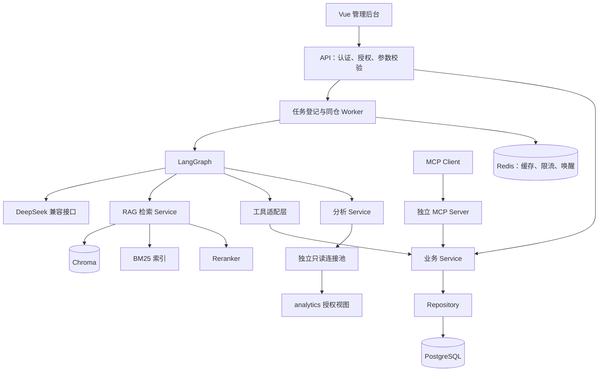

# 架构与实体关系

## 当前实现范围

本文件描述已确认的目标架构，并区分已实现与后续设计。**Phase 2 已实现 FastAPI 基础层、PostgreSQL / Alembic、15 张业务表、模拟数据、JWT 认证、订单与退款 Service / Repository / API、用户确认、幂等、审计和基础设施 Compose。Agent、RAG、MCP、分析、Worker 和前端尚未实现。**

当前启动建立已配置的 PostgreSQL、Redis 客户端；`/health/ready` 实际检查数据库连通、迁移 head、业务所需权限和应用账号权限，并在配置 Redis 时 PING。数据库缺失、未迁移、必要权限缺失、超级用户、库/表 owner 或订单状态/审计超额写权限均返回 503。不自动迁移或 seed，也不连接未实现的 Chroma / 模型。

## 设计目标

EnterpriseAgent 是个人求职作品，使用模拟电商数据，采用能解释、能测试的工程边界。首版为单企业、单 Agent、多工具，不引入 Kubernetes、多租户组织树或独立业务微服务。

主要业务闭环：客户查询订单与物流 → 检索适用售后政策 → Service 依据数据库事实判断 → 用户确认提交 → 创建待审核退款和工单 → 客服审核 → 标记模拟退款完成。知识问答和运营分析通过同一任务工作流处理。

## 模块化单体



上图为目标架构。Phase 2 的 API、Service、Repository、PostgreSQL 及 Redis 登录限流已落地。后续 Worker 与 MCP 将是同仓的不同入口，共享业务逻辑和版本；首版一个 Worker 处理索引和 Agent 任务。PostgreSQL 保存任务及租约，Redis 负责唤醒与缓存，避免 Redis 数据丢失导致业务任务消失。

| 层 | 职责 | 边界 |
| --- | --- | --- |
| API | HTTP、认证上下文、参数和响应 | 不在路由内编写退款规则 |
| Schemas | Pydantic 输入输出与工具参数 | 不承担事务或模型调用 |
| Service | 归属、权限、政策、幂等、事务、审计 | 所有业务写入都经过此层 |
| Repository | SQLAlchemy 查询与持久化 | 不执行模型生成的任意业务写入 |
| Agent | 编排、工具选择、证据和确认流程 | 不持有直接修改订单状态的工具 |
| Tools | 将受校验的工具参数转为 Service 调用 | 用户身份来自认证上下文 |
| RAG | 解析、索引、检索、重排、引用 | 检索内容不能改变授权规则 |
| Analytics | SQL 生成约束、验证与只读执行 | 使用独立账号和连接池 |
| MCP | 协议与工具发现适配 | 直接调用共享 Service，避免重复业务逻辑 |

## 当前代码结构

包采用 `src/enterprise_agent` 布局，通过可编辑安装导入。`application.py` 提供 `create_app(settings=None, configure_logs=True)`；导入该工厂模块不会读取真实 `.env` 或创建应用，测试通过它注入配置并控制日志初始化。包内 `main.py` 创建并暴露 ASGI `app`，同时重新导出工厂。仓库根目录 `main.py` 调用 `cli.py`，使用配置启动 Uvicorn，并保留项目 JSON 日志配置、关闭原始 access log。

配置通过 Pydantic Settings 读取 `EA_` 环境变量，SecretStr 保护密钥的默认表示。配置业务数据库时必须提供至少 32 字符 JWT Secret。`database.py` 创建异步连接池，`security.py` 负责 Argon2 与 JWT，`seed.py` 初始化模拟数据。请求提供统一错误与 `X-Request-ID`，日志不采集请求体、查询字符串或 Authorization。

当前运行 API 使用 `ea_app`；集成测试使用另一数据库的 `ea_test_app`。两个账号均非 owner、非超级用户，并无迁移权限。`ea_local_admin` 仅用于本地迁移与 seed。应用读取政策但不能修改发布版本；审计表仅追加。数据库间 CONNECT 权限隔离，集成测试不能连接开发库。

运行账号仅有当前业务所需的逐表权限；订单只提供 id 列 UPDATE 以满足 FOR UPDATE 行锁权限，状态和金额更新不授权。没有未来模块的通用写权限；新增知识库、任务等功能时需要显式迁移授权和测试。

## 目标目录

以下为后续逐步建立的目录，不能据此推断对应模块当前已实现。

```text
src/enterprise_agent/
├─ application.py
├─ main.py
├─ cli.py
├─ config.py
├─ logging_config.py
├─ request_context.py
├─ api/
│  ├─ dependencies.py
│  └─ routes/                   # auth/orders/refunds/knowledge/agent/analytics
├─ schemas/
├─ models/
├─ repositories/
├─ services/
├─ agents/
│  ├─ graph.py
│  ├─ state.py
│  ├─ nodes/
│  └─ prompts/
├─ tools/
├─ rag/
│  ├─ parsers/
│  ├─ chunking.py
│  ├─ embeddings.py
│  ├─ retrieval.py
│  ├─ reranking.py
│  └─ indexing.py
├─ analytics/
│  ├─ sql_validator.py
│  └─ metrics.py
├─ mcp/
│  ├─ server.py
│  └─ client_example.py
└─ worker.py

alembic/
data/knowledge/
data/fixtures/
evals/datasets/
evals/configs/
evals/results/
frontend/src/{api,components,views,router,types}/
deploy/
.github/workflows/
```

## 数据库实体

以下 15 张业务表已在 Phase 2 的 Alembic 迁移中实现，另有 Alembic 自己的版本登记表。客户由 `users` 中的角色表示，不重复维护客户账户。会话、任务、Chunk 表是后续功能的实体基础，当前没有 Agent 或向量索引写入流程。

| 表 | 关键字段与约束 |
| --- | --- |
| `users` | 登录名唯一、Argon2 哈希、角色、启用状态、JWT 撤销版本 |
| `products` | SKU 唯一、名称、类目、价格、售后属性 |
| `orders` | 订单号唯一、客户 FK、状态、商品金额/运费/实付、支付和签收时间 |
| `order_items` | 订单 FK、商品 FK、交易名称/价格快照、数量、优惠分摊后实付 |
| `logistics` | 订单 FK 唯一、模拟运单号、物流状态、事件；首版一单一包裹 |
| `refund_requests` | 订单 FK、申请人、金额、原因、状态、适用政策版本 FK、审核信息 |
| `support_tickets` | 订单 FK、可选退款 FK、负责人、状态；退款关联唯一 |
| `knowledge_documents` | 标题、类型、文件摘要、版本、可见性、索引状态 |
| `agent_tasks` | 会话 FK、任务类型、状态、步骤、耗时、Token、失败原因、执行租约 |
| `audit_logs` | 操作者、动作、资源、请求 ID、必要变更摘要、时间 |
| `knowledge_chunks` | 文档 FK、索引版本、文本、页码/段落位置、Chunk ID |
| `refund_policy_versions` | 有效期、适用类目、期限、运费规则、来源文档、规则版本 |
| `agent_sessions` | 会话所有者、LangGraph thread ID、创建时间 |
| `approval_requests` | 可选任务 FK、确认人、订单 FK、操作快照及摘要、有效期、确认/消费状态 |
| `idempotency_records` | 操作者、操作、幂等键、参数摘要、结果引用；组合唯一 |


LangGraph Checkpointer 计划在 Phase 4 使用自己的 PostgreSQL 表，目前尚未创建。业务任务摘要不替代图状态，图状态也不替代退款事务或审计。

### 数据一致性

- 金额用整数分；数量为正，金额为非负，避免浮点舍入问题。
- 订单明细保留交易快照，商品改价不影响历史订单。
- 主外键与唯一约束保护实体关系；归属、时间、退款状态和任务状态建立合适索引。
- 退款申请、工单、幂等记录和审计在同一事务提交。
- 提交退款时锁定订单并再次读取资格，不能仅信任先前模型或页面结果。
- 同一订单最多一笔待审核、已批准或模拟完成的退款；拒绝/撤销后按规则允许重试。
- 同一个幂等键、相同参数返回原结果；参数不同返回冲突。
- 已发布政策通过 PostgreSQL trigger 禁止 UPDATE / DELETE，申请保留规则版本和计算快照。
- 政策版本以支付时间选择最新已生效 `valid_from`，再检查 `valid_until`；最新版本失效时不回退旧版本。有效起点与版本建立唯一约束。
- 同键并发先获得 PostgreSQL 事务级 advisory lock；订单行锁、有效退款唯一约束保护不同键并发。
- 未来文档删除会退出检索并保留历史快照；删除与索引 API 尚未实现。

### 模拟数据

种子默认使用随机种子 42、500 个订单，`seed.ps1` 默认日期为当天。Phase 2 实际以 `-AsOf 2026-10-12` 生成约 90 天事实、25 个用户、30 个商品、500 订单、1016 明细、456 物流、19 退款及工单、5 文档、41 审计。种子事务获得 advisory lock，重复运行返回现有统计，不覆盖或 reset；密码哈希随机 salt 不作为业务事实可复现要求。

`10086` 属于 `demo_customer`；`10087` 属于另一客户；`10088` 签收已超 7 天；`10089` 未支付；`10090` 有已模拟完成的退款。5 份 Markdown 政策登记为 uploaded，尚未产生 Chunk 或向量。API 使用当前 UTC，固定 seed 日期会逐渐过期；业务集成测试注入固定时钟，避免测试随日期漂移。全部数据为虚构内容。

## 业务权限与退款边界

当前认证使用 Argon2 哈希、默认 30 分钟 JWT，每个请求从数据库重读启用状态、角色和 token_version。角色为客户、客服、运营分析员、管理员。客户只读取自己的订单和退款，跨用户返回 404；客服与管理员可查询订单及审核售后；分析员不能读取订单详情。任务、脱敏分析视图、知识库和用户管理权限在相应阶段实现。

配置 Redis 时，登录通过原子计数按 IP 限流，默认 10 次 / 60 秒，Redis key 中使用 JWT Secret 的 HMAC 隐藏 IP。Redis 不可用时登录返回 503；未配置 Redis 则没有这项限流保障。CORS 不替代身份或归属校验。

归属过滤在 Service / Repository 读取时执行，不能先读取全部敏感数据再依赖模型隐藏。模型可提交订单号，不能提供替代认证身份的 `user_id`。

当前支持整单退款。`refund-preview` 由 Service 保存 30 分钟待确认操作，绑定用户、订单、金额、原因、政策和订单事实摘要；`POST /refunds` 必须提交 approval_id、严格布尔 confirmed 及幂等键。确认时锁定记录与订单并重查事实，变化、过期、其他用户或已消费确认被拒绝。拒绝确认不创建退款和工单。

用户确认只创建待审核申请；客服审核与模拟完成使用独立接口和状态校验，不连接真实退款服务，不修改订单支付状态。所有写入记录必要审计摘要。LangGraph 人工中断属于 Phase 4，当前只是后端业务确认协议。

售后政策分两层：知识文档解释并提供引用，结构化政策字段供 Service 确定性判断。上传文档不自动发布新业务规则；缺少有效规则时不能通过模型推断规则来批准申请。

## RAG 与索引一致性

Phase 3 处理 PDF、DOCX、TXT 和 Markdown。PDF 先支持文本解析，扫描 PDF OCR 暂不包含。Chunk 保留页码、标题、段落或行号，初始大小约 300–400 个模型 Token，后续按开发集调优。

向量和中文 BM25 各自召回，通过 RRF 融合后交给 BGE Reranker。结果携带文档 ID、版本、Chunk ID 与来源位置。文档可见性、删除状态和当前索引版本以 SQL 登记为准，避免 Chroma 或 BM25 旧条目进入最终证据。

索引任务在解析、Embedding、向量与 BM25 构建完成后发布索引版本。失败保留原因并允许重建；不把部分索引成功显示为已完成。工作流检查证据并允许一次查询改写，最终仍不足时明确说明。

## 只读分析

Phase 6 建立脱敏 `analytics` 视图和独立数据库账号。SQL 生成只获得授权视图、列与指标定义。解析 PostgreSQL AST，递归检查 CTE、子查询和 JOIN；限定单条只读查询、关系、列和函数白名单。

拒绝写入 CTE、`SELECT INTO`、行锁、递归查询和未授权关系。查询使用只读事务、数据库超时、行数与字节上限。分析账号只获得指定视图的 `SELECT`，不获得业务基表修改权限。真实 PostgreSQL 测试才作为权限和超时成立的证据。

默认指标：销售额为支付订单的优惠后商品实付，排除运费且尚未扣减退款；订单量为期间创建订单数，包含取消订单；本月退款率为本月支付订单中截至查询时已模拟退款完成的订单数占比。数据库保存 UTC，业务区间按 `Asia/Shanghai` 解释。报告只描述数据支持的结果，不推断营销或竞争原因。

## 前端与可观测性

Vue 后台规划五页：Agent 对话、订单与售后、知识库、运营分析、任务详情。Markdown 禁用原始 HTML；展示引用、工具步骤、状态和人工确认内容。前端不保存模型密钥，也不直接访问数据库、Chroma 或 MCP。

Phase 1 已提供 HTTP 请求关联和 JSON 日志。后续补充任务步骤、工具耗时、模型耗时、实际 Token 与失败原因。Langfuse 为可选接入，默认关闭；涉及业务内容的 trace 先裁剪和脱敏。

## 执行与验证顺序

按数据库 → RAG → Agent → MCP → 分析 → 前端 → Evaluation → 全栈交付推进。每阶段使用对应真实基础设施验收必要边界；单元测试或配置验证不代替模型、数据库、浏览器和 Docker 的执行证据。
