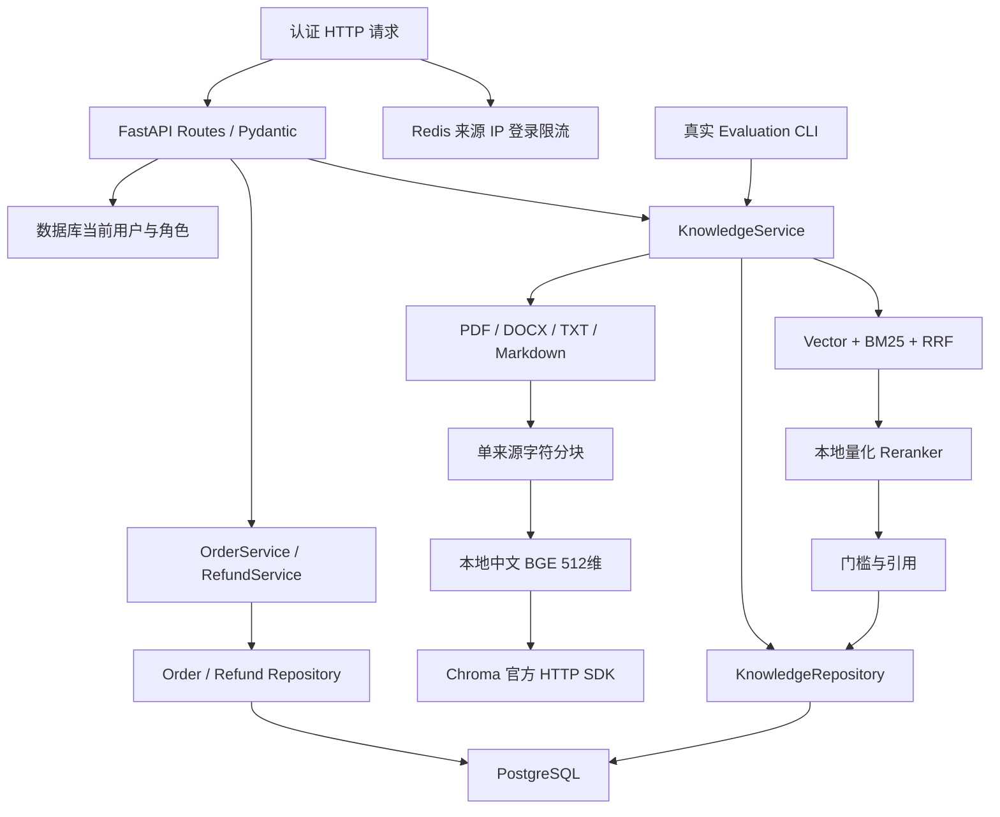
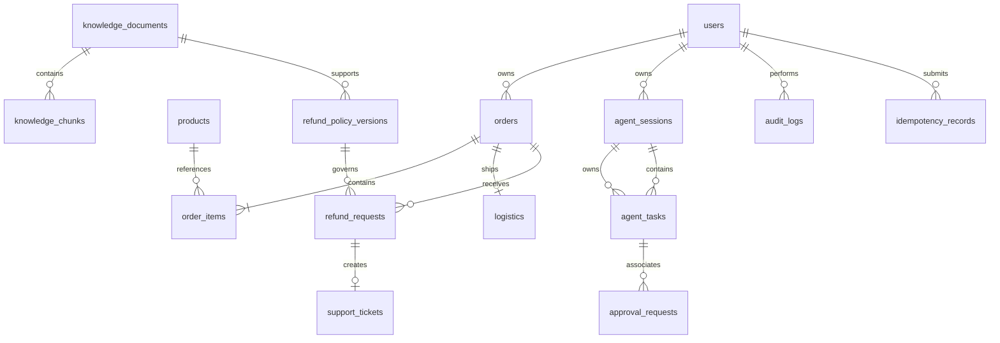

# 架构与实体关系

## 当前实现

Phase 3 的可运行范围是 FastAPI、PostgreSQL、Redis 登录限流、订单退款 Service、知识库管理、真实中文 RAG 检索及评估 CLI。**知识接口返回引用证据，不调用聊天模型生成答案。** LangGraph、MCP、NL SQL、Vue、独立 Worker 与 Langfuse 尚未实现。

采用模块化单体：API、Service、Repository、Schemas 分工明确，模型和前端不能自行修改订单状态或替换当前用户身份。任务表存在不代表图执行或任务队列已落地。

## 代码分层

| 层 | 实际职责 |
| --- | --- |
| API | HTTP、可信认证上下文、Pydantic、上传体限制及响应 |
| Service | 归属、角色、政策、确认、幂等、事务、知识索引及审计 |
| Repository | SQLAlchemy 查询，文档可见性与活动索引代数过滤 |
| Schemas | 输入与结构化返回；不保存数据库连接或执行规则 |
| RAG parsing/chunking | 真实文档解析、来源位置、字符预算与覆盖 |
| RAG backends/runtime | 固定模型文件验证、CPU 推理、线程容量和超时 |
| RAG store/ranking | Chroma SDK、中文字符/二元组 BM25 与 RRF |
| Evaluation | 固定 corpus、文档级排序、门控、引用合法性和真实耗时 |

`application.create_app` 为可注入工厂；导入不会创建运行实例或提前读取用户环境。生命周期按配置建立数据库、Redis 和 RAG runtime，关闭时等待实际推理线程并释放连接。根目录 `main.py` 使用项目 CLI、JSON 日志及 Windows Selector 事件循环。

知识索引在 HTTP 请求或 CLI 中执行，没有 Redis 工作队列。解析、分块及模型/向量工作通过 Runtime 工作线程与统一容量/超时执行；一次允许一个实际任务，外层超时后线程仍持有容量，直至实际结束，避免连续超时创建无限线程。

## 数据与实体

15 张业务表来自 `0001_ecommerce`，`0002_knowledge` 增加索引发布状态和政策来源保护，另有 Alembic 版本表。

| 表 | 关键内容 |
| --- | --- |
| users | 登录名、Argon2、角色、启用状态、token_version |
| products | SKU、名称、类目、整数分价格 |
| orders | 订单号、客户、状态、货款/运费/实付、支付与签收时间 |
| order_items | 商品与价格快照、数量、优惠分摊后实付 |
| logistics | 一单一包裹、模拟运单、状态和事件 |
| refund_requests | 订单、申请人、金额、原因、政策版本/快照、审核及模拟完成 |
| support_tickets | 订单、可选退款关联、负责人、状态 |
| knowledge_documents | 原件 checksum、可见性、版本、索引尝试与活动代数、job ID、fingerprint、错误 |
| knowledge_chunks | 文档 FK、索引代数、Chunk 序号、文本、来源位置 |
| refund_policy_versions | 生效期、退款窗口、运费和类目规则、公开文档来源 |
| approval_requests | 用户、订单、可选任务、摘要、有效期和消费状态 |
| idempotency_records | 操作者/操作/Key 唯一、参数摘要、结果 |
| audit_logs | 操作者、动作、资源、请求 ID、必要摘要 |
| agent_sessions | 用户、thread ID；暂无会话 API |
| agent_tasks | 会话、用户、类型、状态、steps、token_usage、错误；暂无任务执行 |

## 业务与权限边界

金额使用整数分，明细保留交易快照。客户查询订单和退款时直接按归属过滤，不先读取其他用户数据再依靠模型隐藏。客户仅可确认自己的申请；客服和管理员单独审核，模拟完成不会执行真实退款或修改订单支付状态。

确认绑定用户、订单、金额、原因、政策与事实摘要，默认有效 30 分钟。Service 确认时重查数据库并锁定订单；同 Key 使用事务 advisory lock，同订单使用行锁与活动退款部分唯一约束。退款、工单、幂等与审计一起提交。

文档解释与可执行政策分离。退款按支付时适用的最新已生效结构化版本判断，已发布政策禁止 UPDATE/DELETE。来源文档必须公开、存在且未删除，发布时加锁防并发变更；引用该文档的政策存在时禁止改标题、类型、路径、checksum、版本、可见性或删除状态，但可以更新索引状态。新上传文档不会自动发布业务规则。

知识可见性：customer、analyst 仅公开文档，support、admin 可见公开及内部文档；上传、删除、重索引只允许 admin。列表、下载、检索和引用都经过相同 SQL 权限规则。

数据库运行账号不是 owner、超级用户或建表账号。订单仅授予 id 列 UPDATE 供行锁；状态和金额无写权限，审计仅 SELECT/INSERT，政策只能读取。确认、退款、工单、幂等及 Agent 任务/会话表具有迁移明确授予的 DML 权限；后两者尚无执行/API。Phase 3 明确增加 knowledge_documents INSERT/UPDATE 与 knowledge_chunks INSERT/DELETE，不提供修改 Chunk 或物理删除文档的业务路径。

## 解析、模型和检索

PDF 使用 pypdf 文本层，空白/扫描件明确拒绝，不包含 OCR。DOCX 使用 python-docx 正文和表格，包括嵌套表格；页眉页脚、修订文本和文本框不在当前范围。TXT/Markdown 仅严格 UTF-8，支持 BOM；不猜 GBK，不用替换字符掩盖编码失败。文件格式与内容匹配、ZIP 展开/成员/XML 大小、DTD/实体、重复路径、宏包均有检查。

分块不跨来源 section，默认 500 字符、重叠 80，保留页、段落、表格、行号和字符范围。**字符数不是 Token 数**，模型输入上限 512 Token，SDK 会截断较长输入；并不保证超长 Chunk 全文均参与语义计算。

Embedding 为 BAAI/bge-small-zh-v1.5 的固定 ONNX 导出，512 维、CLS 与 L2 归一化；检索提示只用于 query。Reranker 为固定 Xenova/bge-reranker-base 量化 ONNX 导出，返回 logit 经 sigmoid 得到的 0–1 未校准分数，不能当作概率。所有文件的仓库 revision、大小与 SHA256 固定并校验，CPU 推理，禁止自动模型下载。

向量候选最多 30，BM25 用中文字符/二元组及英文数字业务标识，也最多 30；RRF k=60 融合后最多 30 个候选再重排。BM25 从当前可访问 SQL Chunk 构建，没有独立持久倒排索引或 Redis 检索缓存。

相关性阈值用于保守筛选候选，不能证明语义足够、政策无冲突或开放问题可回答。所有模式需满足向量相似度门槛，hybrid_rerank 还需同时满足 sigmoid 重排门槛。`evidence_found` 表示有候选通过门槛；`insufficient_evidence` 明确说明无法确认。当前没有 LLM 生成、查询改写或 Agent 工作流。

## 跨存储索引一致性

索引事务先锁文档，登记新的尝试代数、随机 job ID 与开始时间。原件按不可变路径/checksum 读取，解析、分块、真实 Embedding 和 Chroma 写入完成后，再在 PostgreSQL 发布活动代数、Chunk 和 fingerprint。

发布前必须确认 job ID、尝试代数、原件 checksum 仍一致；超时旧尝试不能覆盖新尝试。失败留下错误，已有活动索引可以继续用；首次失败没有有效索引。删除先从 SQL 登记退出并移除 Chunk，再尽力清理向量。

检索前用 SQL 限定可见文档、当前代数、fingerprint 和活动索引 ID，向量查询限定对应 index_id；模型调用后再读取 SQL 当前状态。失效或不可访问 Chunk 不能成为最终引用。引用 API 单独验证当前权限和版本。

SQL 与 Chroma 不是同一事务，没有分布式事务。数据库开始持久化后，即使提交结果未知也不会删除已写原件，避免已提交记录失去来源；仅文件写失败会清理。代价是取消或未知提交可能留下未登记原件。旧向量清理失败也可能保留不可检索条目，当前没有维护清理工具。状态/job 字段是同步索引的并发控制，不代表独立持久 Worker 或自动恢复调度。

Chroma 使用官方 1.5.9 SDK，针对其 HTTP session 的窄兼容桥在首次身份/租户/数据库请求前设置有限 timeout，使用官方 System、ServerAPI 和 Collection。桥不改 SDK 全局对象，升级版本必须复查真实 HTTP 测试；不会用虚构配置字段声称超时已生效。

## 健康与部署

当前运行分布为 Windows Python API/ONNX，Linux PostgreSQL、Redis 和 Chroma 容器，数据与模型优先 D 盘。健康区分进程存活与依赖就绪：数据库检查迁移/权限，Redis 配置后 PING，RAG 启用后校验模型文件与 Chroma 心跳。健康通过不证明所有文档已索引或所有查询正确。

## 后续架构

Phase 4 以单 LangGraph 图复用现有 Service，建立可信 State、Tool Calling、Checkpoint、多轮、有限执行和人工中断。Phase 5 的 MCP 只作为协议入口；Phase 6 的分析使用独立只读账号/视图/AST；Phase 7 实现五页 Vue 后台。任务调度、应用镜像、CI 和 tracing 在确有实现及验证后加入文档，不把目标图当作当前运行能力。
