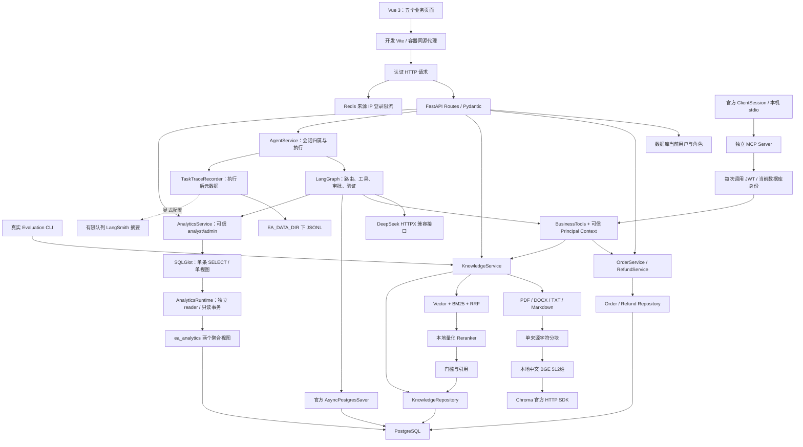
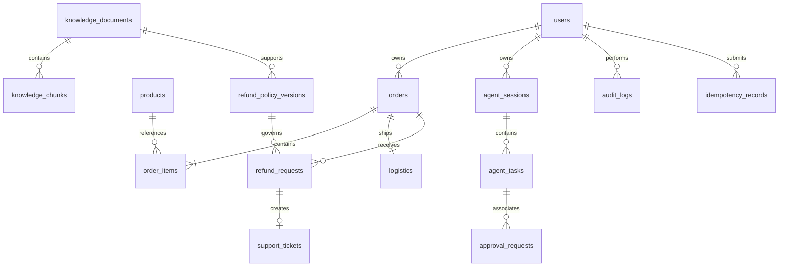

# 架构与实体关系

## 当前实现

Phase 9 / 0.9.0 在模块化单体、Vue 五页、单张 LangGraph 图、独立分析 reader、只读 MCP、评估合同和元数据追踪之外增加 Linux 应用镜像与独立全栈部署。评估器采集真实任务/授权业务参考，再执行显式证据检查；受控故障注入单独标记。追踪默认写本地白名单 JSONL，可选 LangSmith 摘要导出默认关闭。部署验证见[Phase 9](phase-9.md)，[Phase 8](phase-8.md)及更早证据保留历史边界；没有独立 Worker。

采用模块化单体：API、Service、Repository、Schemas、Agents、Tools 分工明确，模型和前端不能自行修改订单状态或替换当前用户身份。图随请求执行，人工等待写入 Checkpoint；没有任务队列 Worker。

## 代码分层

| 层 | 实际职责 |
| --- | --- |
| API | HTTP、可信认证上下文、Pydantic、上传体限制及响应 |
| Frontend API / auth | 固定本站 API 路径、Bearer 内存会话、错误/request ID、到期和身份变化处理 |
| Frontend views / components | 五页业务交互、真实 DTO、安全 Markdown、来源核验、审批/恢复与 SVG 图表 |
| Service | 归属、角色、政策、确认、幂等、事务、知识索引及审计 |
| Repository | SQLAlchemy 查询，文档可见性与活动索引代数过滤 |
| Schemas | 输入与结构化返回；不保存数据库连接或执行规则 |
| RAG parsing/chunking | 真实文档解析、来源位置、字符预算与覆盖 |
| RAG backends/runtime | 固定模型文件验证、CPU 推理、线程容量和超时 |
| RAG store/ranking | Chroma SDK、中文字符/二元组 BM25 与 RRF |
| Evaluation / evaluations | 固定 corpus、严格案例合同、真实证据、SQL 独立基表参考、机器检查与人工复核状态 |
| Observability | 显式字段白名单、累计 Task 快照、本地 JSONL、可选有界远端摘要队列 |
| Agents graph | 状态、模型规划、一次检索改写、人工中断、执行预算及结果验证 |
| Agents llm | OpenAI 兼容 HTTP 协议、有限响应与超时、严格 Tool Call / usage 校验 |
| Agents checkpoint | 官方 PostgreSQL saver、私有 thread advisory lock、安全序列化 |
| Tools | 参数白名单、可信身份注入、复用业务 Service，模型不能确认写入 |
| MCP | 官方低层协议适配、三个只读工具发现、每次调用认证与共享参数校验、stdio 生命周期 |
| Analytics catalog/sql | 固定聚合视图、业务指标口径、PostgreSQL AST 节点与列白名单 |
| Analytics runtime/Service | 专用连接池与权限就绪检查、只读事务/超时、精确受限结果与确定性报告 |

`application.create_app` 为可注入工厂；导入不会创建运行实例或提前读取用户环境。生命周期按配置建立数据库、Redis、RAG、Checkpoint、分析连接池与可选模型 Client，关闭时释放 HTTP/数据库连接并等待实际推理线程。根目录 `main.py` 使用项目 CLI、JSON 日志及 Windows Selector 事件循环。

知识索引在 HTTP 请求或 CLI 中执行，没有 Redis 工作队列。解析、分块及模型/向量工作通过 Runtime 工作线程与统一容量/超时执行；一次允许一个实际任务，外层超时后线程仍持有容量，直至实际结束，避免连续超时创建无限线程。

## 前端状态与信任边界

前端位于 `frontend/`，Vite 仅绑定 `127.0.0.1:5173`，代理 `/api/v1` 和 `/health` 到 loopback FastAPI。浏览器不持有 DeepSeek Key、数据库 URL 或 JWT 签名秘密。登录 Token、用户和有效期只保存于响应式内存；刷新或关闭页面需重新登录，不使用 localStorage / sessionStorage 保存 Token。认证失败和到期清理身份，延迟返回的旧登录请求不能覆盖当前身份页面。

角色控制只决定按钮和页面提示。订单归属、文档可见性、会话创建角色、审批有效期和 SQL 访问权限仍由后端实时验证。任务页面读取自己的持久化任务，不从客户端提供 user_id、thread 或 Graph 配置。前端依据 `Task.status` 和文档 `status/index_error_code` 显示结果，HTTP 200 / 201 不代表任务完成或索引可用。

订单页面将未决退款的审批、原幂等键和明确决定保存在模块内 Map，按当前账号 ID 取用，使页面切换后可手动核对并保留原请求。该 Map 不是数据库或持久队列，刷新页面会丢失；最终事务幂等、审计与重复申请约束在服务器。Agent 提交结果不明时先锁定发送，用户显式刷新会话读取持久状态；恢复与审批均由用户点击，不自动推进任务。

Markdown 使用 marked + DOMPurify，禁用远程图片、嵌入文档、表单和主动 HTML；引用原文采用文本插值。核验根据 chunk_id 构造认证 API 路径，不导航模型提供的任意 citation_url。历史任务中的来源快照与当前引用 API 的合法性分别展示，不能把已保存原文当作刚完成的权限或版本核验。图表从后端 `query_rows` 规范读取，精确十进制值保留于表格和提示，比例绘图不补 NULL 为零。

Phase 7 时前端行为由 43 项受控单元/组件测试验证，21 项 API 回归核对当时 0.7.0 契约；真实 Edge 另行连接专用业务数据库、reader、CPU 检索和配置模型完成 14 个检查点，包含 Checkpoint 跨服务重启后的确认。该历史流程只操作虚构记录，不代替模型质量或部署证明。本阶段重跑 43 项前端检查及实际后端套件，新的测试与模型范围见[Phase 8](phase-8.md)，历史浏览器失败/消费仍见[Phase 7](phase-7.md)。

## 数据与实体

15 张业务表来自 `0001_ecommerce`，`0002_knowledge` 增加索引发布状态和政策来源保护，`0003_agent` 补充会话任务状态、审批任务唯一绑定和官方 Checkpointer 的 `ea_checkpoint` schema，`0004_agent_role` 固定会话创建角色，`0005_analytics` 建立 `ea_analytics` 的两个视图与版本标记；另有 Alembic 版本表。官方 Checkpoint 的四张内部表和分析视图不当成额外业务实体。

| 表 | 关键内容 |
| --- | --- |
| users | 登录名、Argon2、角色、启用状态、token_version |
| products | SKU、名称、类目、整数分价格 |
| orders | 订单号、客户、状态、货款/运费/实付、支付与签收时间 |
| order_items | 商品与价格快照、数量、优惠分摊后实付 |
| logistics | 一单一包裹、模拟运单、状态和事件 |
| refund_requests | 订单、申请人、金额、原因、政策版本/快照、审核及模拟完成 |
| support_tickets | 订单、可选退款关联、负责人、状态 |
| knowledge_documents | 原件 checksum、可见性、版本、索引尝试与活动代数、job ID、fingerprint、错误 |
| knowledge_chunks | 文档 FK、索引代数、Chunk 序号、文本、来源位置 |
| refund_policy_versions | 生效期、退款窗口、运费和类目规则、公开文档来源 |
| approval_requests | 用户、订单、可选任务、摘要、有效期和消费状态 |
| idempotency_records | 操作者/操作/Key 唯一、参数摘要、结果 |
| audit_logs | 操作者、动作、资源、请求 ID、必要摘要 |
| agent_sessions | 用户、不可变创建角色、私有 thread ID、当前任务指针、创建与更新时间；API 同时校验所有者和当前角色 |
| agent_tasks | 消息、会话、用户、类型、状态、结果、steps、token_usage、错误和耗时 |

## 业务与权限边界

金额使用整数分，明细保留交易快照。客户查询订单和退款时直接按归属过滤，不先读取其他用户数据再依靠模型隐藏。客户仅可确认自己的申请；客服和管理员单独审核，模拟完成不会执行真实退款或修改订单支付状态。

确认绑定用户、订单、金额、原因、政策与事实摘要，默认有效 30 分钟。Service 确认时重查数据库并锁定订单；同 Key 使用事务 advisory lock，同订单使用行锁与活动退款部分唯一约束。退款、工单、幂等与审计一起提交。

文档解释与可执行政策分离。退款按支付时适用的最新已生效结构化版本判断，已发布政策禁止 UPDATE/DELETE。来源文档必须公开、存在且未删除，发布时加锁防并发变更；引用该文档的政策存在时禁止改标题、类型、路径、checksum、版本、可见性或删除状态，但可以更新索引状态。新上传文档不会自动发布业务规则。

知识可见性：customer、analyst 仅公开文档，support、admin 可见公开及内部文档；上传、删除、重索引只允许 admin。列表、下载、检索和引用都经过相同 SQL 权限规则。

数据库运行账号不是 owner、超级用户或建表账号。订单仅授予 id 列 UPDATE 供行锁；状态和金额无写权限，审计仅 SELECT/INSERT，政策只能读取。确认、退款、工单、幂等及 Agent 任务/会话表具有迁移明确授予的 DML 权限。Phase 3 明确增加 knowledge_documents INSERT/UPDATE 与 knowledge_chunks INSERT/DELETE，不提供修改 Chunk 或物理删除文档的业务路径。

`ea_checkpoint` 仅由 `0003_agent` 建立并保存 SDK schema 版本。运行账号具有 schema USAGE、检查点数据表 SELECT/INSERT/UPDATE、版本表 SELECT，没有 schema CREATE、DDL、检查点 DELETE 或版本变更权限；应用不调用 saver.setup()。

## 运营视图、指标与 SQL 边界

`ea_analytics.daily_orders` 按 `(paid_at AT TIME ZONE 'Asia/Shanghai')::date` 聚合，仅包括有支付时间且状态为 paid / shipped / delivered 的订单。输出支付订单数、商品实付、运费、毛实付以及模拟完成退款订单数和金额。退款先按订单聚合，再与订单连接，避免退款历史记录放大销售金额。收入不扣退款；完成退款率属于支付日期 cohort，完成日期不作为分组日期，不能解释成某期间的退款事件率。

`daily_product_sales` 按支付日期、product_id、交易时商品名称和类目快照聚合件数及商品实付，不含运费。相同商品的不同历史名称可能分组出现，商品金额不因当前 products 名称变更而变化。两个视图都不暴露用户、订单号、地址或密码哈希。

迁移账号拥有视图，显式设置 security_barrier=true / security_invoker=false，reader 通过视图 owner 的基表权限读取聚合结果。`ea_analytics_reader` 只获开发项目库 CONNECT，`ea_test_analytics_reader` 只获测试项目库 CONNECT；两项目库之间不可交叉连接。专用角色没有角色成员关系、对象 ownership、schema CREATE、基表/列或 sequence 权限，只显式授予分析 schema USAGE 与两个视图 SELECT。初始化撤销两项目库 PUBLIC TEMP，保留已有 PUBLIC public-schema USAGE 以及系统数据库的默认权限；数据库身份仍可读取部分系统元数据，SQL AST 再限制应用查询来源。

分析入口限 analyst / admin，身份取自共享实时认证，普通客服不因能读取订单就获得分析权限。运行池与业务池分开，reader 默认只读；每次查询再设置 READ ONLY、statement_timeout、lock_timeout、上海时区和 pg_catalog search_path。就绪检查核对精确角色、库名、schema marker、视图列类型、限定授权及无危险 ownership/成员关系。reader 不获得 `public.alembic_version`，业务 Database 单独验证全局迁移 head。

SQLGlot 30.22.0 解析 PostgreSQL 方言，按精确 AST 类型白名单接受单条 SELECT，显式引用一个授权视图及已登记列。禁止 JOIN、CTE、子查询、UNION、窗口函数、写入、锁、任意函数与其他 schema；星号仅允许 COUNT(*)。允许有限聚合、算术、条件、分组、排序和指定类型转换，详见[API](api.md)。这层约束控制执行能力，不能证明指标、日期范围或模型语义正确。

默认返回最多 100 行、20 列，SQL 使用上限加一行探测截断；调用方更小的 LIMIT 保留。金额的 PostgreSQL NUMERIC 转为精确十进制字符串，不先转换浮点；单个字符串单元格最多 512 字符，行数据 JSON 预算 100 KiB。超时和异常退出事务，底层 SQL/DSN 异常不回显。报告只使用执行结果，正文展示前 20 行，保留完整受限 query.rows；无结果和截断有明确提示，不自动补零或推断业务原因。Vue 分析与任务详情消费同一图表规范，图表最多绘制前 30 行，完整受限结果由表格展示。

## 解析、模型和检索

PDF 使用 pypdf 文本层，空白/扫描件明确拒绝，不包含 OCR。DOCX 使用 python-docx 正文和表格，包括嵌套表格；页眉页脚、修订文本和文本框不在当前范围。TXT/Markdown 仅严格 UTF-8，支持 BOM；不猜 GBK，不用替换字符掩盖编码失败。文件格式与内容匹配、ZIP 展开/成员/XML 大小、DTD/实体、重复路径、宏包均有检查。

分块不跨来源 section，默认 500 字符、重叠 80，保留页、段落、表格、行号和字符范围。**字符数不是 Token 数**，模型输入上限 512 Token，SDK 会截断较长输入；并不保证超长 Chunk 全文均参与语义计算。

Embedding 为 BAAI/bge-small-zh-v1.5 的固定 ONNX 导出，512 维、CLS 与 L2 归一化；检索提示只用于 query。Reranker 为固定 Xenova/bge-reranker-base 量化 ONNX 导出，返回 logit 经 sigmoid 得到的 0–1 未校准分数，不能当作概率。所有文件的仓库 revision、大小与 SHA256 固定并校验，CPU 推理，禁止自动模型下载。

向量候选最多 30，BM25 用中文字符/二元组及英文数字业务标识，也最多 30；RRF k=60 融合后最多 30 个候选再重排。BM25 从当前可访问 SQL Chunk 构建，没有独立持久倒排索引或 Redis 检索缓存。

相关性阈值用于保守筛选候选，不能证明语义足够、政策无冲突或开放问题可回答。所有模式需满足向量相似度门槛，hybrid_rerank 还需同时满足 sigmoid 重排门槛。`evidence_found` 表示有候选通过门槛；`insufficient_evidence` 明确说明无法确认。Agent 知识分支可改写一次查询，并要求模型选择连续原文；回答前重新验证引用权限、文本和当前代数。

## 跨存储索引一致性

索引事务先锁文档，登记新的尝试代数、随机 job ID 与开始时间。原件按不可变路径/checksum 读取，解析、分块、真实 Embedding 和 Chroma 写入完成后，再在 PostgreSQL 发布活动代数、Chunk 和 fingerprint。

发布前必须确认 job ID、尝试代数、原件 checksum 仍一致；超时旧尝试不能覆盖新尝试。失败留下错误，已有活动索引可以继续用；首次失败没有有效索引。删除先从 SQL 登记退出并移除 Chunk，再尽力清理向量。

检索前用 SQL 限定可见文档、当前代数、fingerprint 和活动索引 ID，向量查询限定对应 index_id；模型调用后再读取 SQL 当前状态。失效或不可访问 Chunk 不能成为最终引用。引用 API 单独验证当前权限和版本。

SQL 与 Chroma 不是同一事务，没有分布式事务。数据库开始持久化后，即使提交结果未知也不会删除已写原件，避免已提交记录失去来源；仅文件写失败会清理。代价是取消或未知提交可能留下未登记原件。旧向量清理失败也可能保留不可检索条目，当前没有维护清理工具。状态/job 字段是同步索引的并发控制，不代表独立持久 Worker 或自动恢复调度。

Chroma 使用官方 1.5.9 SDK，针对其 HTTP session 的窄兼容桥在首次身份/租户/数据库请求前设置有限 timeout，使用官方 System、ServerAPI 和 Collection。桥不改 SDK 全局对象，升级版本必须复查真实 HTTP 测试；不会用虚构配置字段声称超时已生效。

## 健康与部署

开发方式使用 Windows Python API/ONNX 与 Linux PostgreSQL、Redis、Chroma 容器；独立全栈方式将 API/ONNX 和静态前端也放入 Linux 容器，数据与模型仍优先 D 盘。健康区分进程存活与依赖就绪：数据库检查迁移/权限，Redis 配置后 PING，RAG 启用后校验模型文件与 Chroma 心跳，建立 Agent Checkpoint 后检查其版本和受限权限，启用分析时检查专用 reader、视图和权限。健康不发送模型请求，也不能证明在线模型可用、所有文档已索引或所有查询正确。

## Agent 一致性与恢复

Principal 放在可信 `AgentContext`，不从模型参数、图 State 或 resume JSON 决定身份。API 暴露 session/task UUID，内部 thread 随会话生成；每种角色都只能访问自己的会话和任务，且当前角色必须匹配会话创建角色。角色变化需要新会话，恢复原角色后可再次访问原合法会话。官方 saver 只处理字典等允许的数据类型，禁用 pickle fallback 与任意类重建。

同一 thread 使用跨进程 PostgreSQL advisory lock，线程执行时其他 worker 被拒绝；等待人工确认时释放锁和执行资源。模型只准备审批，服务器记录任务关联、金额、原因、适用政策、摘要和有效期。确认后以固定任务幂等键调用同一 RefundService；审批准备也按 task_id 重放原记录。

业务事务与 Checkpoint 没有共同事务。取消请求可能发生在真实审批或退款提交之后，通过 recover 重跑未完成节点，审批唯一绑定和确认幂等保护原记录。需要用户显式恢复，没有后台自动重领。业务提交后的显示引用若失效，仅移除引用并添加 warning_codes，保留数据库已提交结果；敏感操作开始前预留后续执行与验证步数。

## MCP 协议入口

`mcp/server.py` 注册 `query_order`、`query_logistics`、`query_refund_policy`，分别映射现有 BusinessTools 的 get_order、get_logistics 和 get_refund_policy。独立进程使用官方低层 Server 和 stdio transport；ClientSession 初始化、发现并调用这些工具，不经过模型或 LangGraph。协议注解 readOnlyHint 是能力说明，实际限制来自三工具白名单、共享参数校验与现有 Service，而不是注解本身。

每个 Server 进程从 `EA_MCP_ACCESS_TOKEN` 获取一名用户的 JWT。每次工具调用都由 AuthService 校验签名、期限和数据库当前启用状态、token_version、角色，再把 Principal 交给 BusinessTools；arguments 和 `_meta` 不能授予身份。客户只能查所属订单，客服/管理员按现有 Service 权限查询，分析员不能读取订单明细。政策查询限定订单适用政策文档，返回真实资格和检索证据；存在适用政策但 RAG 未启用时返回 rag_not_enabled，不假造引用。

Client/Server 均不读取 `.env`，示例白名单仅向子进程传递必要普通数据库、JWT、用户 Token 和 RAG 配置，排除分析连接并禁用分析 runtime。MCP 使用已有受限业务数据库账号，Phase 6 的专用 reader 仅供分析入口；业务账号仍保有其他流程所需 DML，MCP 的三个入口不暴露写操作。stdout 只用于 JSON-RPC，业务日志写 stderr，仅保存安全工具名、结果、错误码和耗时。

每次认证及业务执行默认总预算 15 秒，客户端示例默认总预算 60 秒。官方异步上下文负责关闭 Session、stdin 与实际子进程；Windows Client 使用 Proactor，数据库 Server 使用 Selector。没有 MCP HTTP/OAuth、Token 自动续期、写入工具或 Agent 图内 MCP 分支。完整协议与运行命令见[API](api.md)、[部署](deployment.md)和[Phase 5](phase-5.md)。

## 全栈部署结构

全栈 Compose 使用独立 `enterpriseagent-full` 项目，保留原有开发基础设施和 Windows 运行方式。PostgreSQL、Redis、Chroma、一次性 setup、API 与 web 为同一个模块化系统的部署组件，不额外拆分业务微服务。setup 执行迁移、模拟 seed 和知识索引；API 只读取受限业务和分析凭据，模型文件只读挂载，Vue 静态站点通过同源代理访问 API。具体脚本、健康条件和实际验收边界见[部署](deployment.md)与[Phase 9](phase-9.md)。

图仍由请求驱动执行，人工等待保存 Checkpoint，不提供独立任务调度 Worker。已有五页真实浏览器与模型流程证据分别保留在 Phase 7 / Phase 8，容器启动不能替代新的模型质量评估。

本次实际六项 readiness 与 13 项 HTTP 检查通过，重建本项目 API 后业务数量、订单状态和文档快照保持一致；另行改变 API 自有地址时，Nginx 保持运行并重新解析代理。容器 inspect 记录 API / web 的运行用户、只读根文件系统、capabilities 和实际挂载，证明配置边界，不泛称整个栈非 root 或生产安全认证。Linux 部署、v2 RAG 与原模型评估分别见[Phase 9](phase-9.md)及[验收报告](../evals/results/phase9/report.md)。

## 评估与追踪数据流

`evaluations/dataset.py` 用 Pydantic 严格加载案例，拒绝未知字段、非白名单预期与不可信订单绑定；`checks.py` 对采集证据给出 `pass`、`fail` 或 `manual_review`，缺少证据不能默认成功。`references.py` 将受支持 SQL 指标/时间范围 AST 合同与独立基表事实结果配合使用，不复用模型 SQL 作事实标准，也不是通用 SQL 等价证明器。`boundaries.py` 运行生产图与 InMemorySaver，模型和业务响应是声明的故障输入，不接数据库或供应商。

`AgentService` 在主动执行结束后记录 Task DTO 的白名单投影，应用 lifespan 统一管理记录器与可选导出线程。`trace_id` 和 root span 关联 Task UUID，每次 send/resume/recover 有独立 segment；节点记录来自 Task 的累计 steps。Token、耗时与步骤保持累计快照语义，汇总按 Task 取最新值；节点 span 为结束后的观察，不能推导真实并行关系或逐节点起止时间。

记录器不序列化完整 Task、消息、回复、工具参数、SQL、文档内容、用户/订单字段或密钥，request ID 保存 SHA256。节点/工具/状态/错误均白名单处理，未知值使用固定类别。本地 I/O 和远端摘要失败只记录安全错误，不改变业务结果；队列有上限，关闭不等待清空全队列。进程内锁没有跨进程日志互斥或轮转，因此本地 JSONL 不能称生产日志管道。

Phase 8 实际在线运行的 17 个 Task 有 17 条本地快照，核对 request hash、状态、安全错误和累计 usage 与 DTO 一致，见[追踪证据](../evals/results/phase8/observability/verification.json)。该账本与在线 39440 Token 相同，不重复汇总；LangSmith 远端未连接验收，步骤快照也不当作实时分布式时序。
